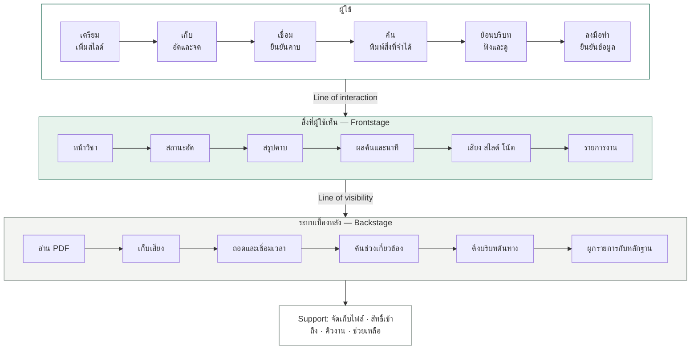

# Sherlock — แผนปรับสไลด์ 20 หน้า พร้อมข้อความและ layout

วันที่ปรับ: 9 ตุลาคม 2569  
เวลานำเสนอ: 7 นาที รวมวิดีโอ MVP 45 วินาที  
ฉบับนี้ย้าย **Lean Canvas ไปหน้า 17 ก่อน Feasibility** และเพิ่ม **diagram ในหน้า 13: Design Development + Service Blueprint**

แหล่งหลัก: `AR - Week 2 แก้ตามอาจารย์ .pptx.pdf` หน้า 1–37 ไฟล์มีทั้งหมด 47 หน้า แต่การปรับครั้งนี้ใช้ขอบเขต 1–37 ตามคำขอ หน้า 37 ใช้เป็นรายการหัวข้อ ไม่ใส่ในชุดนำเสนอ PDF เป็นไฟล์อ้างอิงในเครื่องและไม่ได้รวมใน repository นี้

Diagram ก่อนและหลังใช้ Sherlock: [เปิดไฟล์ diagram](SHERLOCK_BEFORE_AFTER_DIAGRAMS_TH.md)

## 1. Flow ที่ใช้กับผู้ฟังครั้งแรก

**เห็นปัญหา → รู้ว่าเก็บข้อมูลอย่างไร → เข้าใจผู้ใช้ → เห็นจุดติดขัด → เทียบทางเลือก → เลือกแนวคิด → เห็นบริการและหน้าจอ → ดูเดโม → รู้ว่าจะทดสอบอะไร → เห็นรูปแบบธุรกิจ → ความเป็นไปได้และการขยาย**

ชื่อ Sherlock และคำอธิบายสั้น ๆ ปรากฏตั้งแต่หน้าแรก ผู้ฟังจึงรู้ว่ากำลังฟังโครงการอะไร แต่ยังเดินผ่านหลักฐานและเหตุผลออกแบบก่อนเข้าสู่เดโม

ใช้ปัญหาร่วมว่า **“ย้อนหาข้อมูลที่เคยเก็บเมื่อต้องใช้”** ซึ่งครอบคลุมทั้งการทบทวนและการทำงาน แล้วใช้ **“เบลล์ย้อนตรวจคำสั่งก่อนส่งงาน”** เป็นฉากสาธิตหนึ่งฉาก เพื่อให้เรื่องเดโมจับต้องได้

Design Development กับ Blueprint อยู่หน้าเดียว ส่วน Sketch ทำหน้าที่แสดงหน้าจอ และวิดีโอทำหน้าที่แสดงต้นแบบ ไม่เล่ากลไกซ้ำทั้งสามหน้า Lean Canvas อยู่หลังเดโมและแผนทดสอบเพื่อเปลี่ยนจาก “ผู้ใช้ทำอะไรได้” ไปสู่ “บริการนี้ดำเนินต่ออย่างไร”

รายละเอียดหลักฐานและจุดให้เลือกว่าจะพูดอยู่ท้ายเอกสาร ไม่ต้องใส่คำกำกับยาว ๆ ทุกหน้า การตรวจหลายเอเจนต์ใช้ช่วยดูความครบถ้วนและ flow; ยังไม่ใช่การทดลองกับผู้ฟังจริง

## 2. โครงสุดท้ายและเวลา

| ใหม่ | หัวข้อ | หน้าเดิมที่นำมาใช้ | เวลา |
|---:|---|---|---:|
| 1 | จดไว้ อัดไว้ พอจะใช้หาไม่เจอ | 1–2; คำอธิบายโครงการจาก 26 | 10 วิ |
| 2 | Context และโจทย์ตั้งต้น | 3, ฝั่งซ้ายของ 6, 7 | 18 วิ |
| 3 | Data Collection | 8 | 15 วิ |
| 4 | ปัญหาที่พบจากการสำรวจ | 4–5 | 20 วิ |
| 5 | เหตุผลที่เริ่มกับ Active Capturer | 6, 9, 23 | 20 วิ |
| 6 | Persona และ Empathy | 10–13 | 15 วิ |
| 7 | User Journey ปัจจุบัน | 14 | 25 วิ |
| 8 | Competitor Research | 15–16 | 15 วิ |
| 9 | Technology Research | 17 | 18 วิ |
| 10 | Value Proposition Canvas | 18 | 20 วิ |
| 11 | POINT และ Concept Evaluation | 20–21, 24 | 20 วิ |
| 12 | Final Problem Statement / HMW | 22 | 12 วิ |
| 13 | Design Development + Service Blueprint | 19, 25–29; ผลเลือกจาก 24 | 25 วิ |
| 14 | Sketch และ Usage Scenario | 30–31, 33–35 | 12 วิ |
| 15 | MVP / Prototype Demo | 36 และวิดีโอที่มี | 50 วิ |
| 16 | แผน User Testing และ Iteration | 28 และเพิ่มตาม requirement | 22 วิ |
| 17 | Lean Canvas | 32 | 20 วิ |
| 18 | Feasibility: เทคนิคและบริการ | 17, 28 และข้อเสนอเพิ่ม | 20 วิ |
| 19 | Feasibility: รูปแบบราคาและต้นทุน | 32 และข้อเสนอเพิ่ม | 20 วิ |
| 20 | Scalability และ Future Phase | ทิศทางระยะถัดไปจาก 24, 26, 29 และข้อเสนอเพิ่ม | 18 วิ |

รวมการเล่าและเดโม **395 วินาที** เหลือ **25 วินาที** สำหรับเปลี่ยนหน้าและเปิดคลิป รวม 420 วินาทีหรือ 7 นาที เวลารายหน้าเป็นแผนสำหรับซ้อม ยังไม่ได้วัดจากการพูดจริง

ช่วงท้ายตามลำดับที่ปรับ: **14 Sketch → 15 MVP → 16 Testing → 17 Lean Canvas → 18–19 Feasibility → 20 Scalability**

## 3. หน้าเดิม 1–37 ปรับอย่างไร

“ตัดหน้าเดี่ยว” หมายถึงไม่ใช้เป็นอีกหนึ่งสไลด์ แต่สารสำคัญอาจถูกรวมไว้ในหน้าใหม่ “บันทึกผู้พูด” หมายถึงไม่เพิ่มหน้าภาคผนวกในชุด 20 หน้า

| หน้าเดิม | สถานะ | คงอะไร / ปรับและตัดอะไร | ไปหน้าใหม่ |
|---:|---|---|---|
| 1 | คงและปรับ | คง hook และภาพ เพิ่มชื่อ Sherlock กับหน้าที่หนึ่งบรรทัด | 1 |
| 2 | รวม; ตัดหน้าเดี่ยว | รวมบริบทก่อนสอบ/ก่อนส่งงานไว้ในคำเกริ่น ไม่เปิดปัญหาซ้ำอีกหน้า; แก้คำ “ก่อนสั่งงาน” เป็น “ก่อนส่งงาน” ถ้าจะนำมาใช้ | 1–2 |
| 3 | ปรับ | คงสถานการณ์ฟัง จด อัด และประชุม ลดเหลือข้อความ Context ที่จำเป็น | 2 |
| 4 | คงและรวม | คง 50.4%, 75.2%, 66.4% และฐาน 113 คน รวมเป็นหน้าผลสำรวจ | 4 |
| 5 | รวม | คงการจดไม่ทันและวิธีรับมือ ย้ายความกังวลการถอดเสียงไทยไปหน้าเทคนิค | 4, 9, 18 |
| 6 | แยกสารไปตามหน้าที่ | ประเภทข้อมูลไป Context; พฤติกรรม A–D ไปเหตุผลเลือกกลุ่ม ไม่ใช้ภาพรวมเดิมซ้ำทั้งหน้า | 2, 5 |
| 7 | รวม | ย่อ Initial Problem Statement เป็นหนึ่งประโยค อ่านได้ทันที | 2 |
| 8 | คง | คง 121 → 113 คน, สัมภาษณ์ 10 คน และ 29 เหตุการณ์ เปลี่ยน target sample เป็น “ผู้ตอบที่เข้าเกณฑ์” | 3 |
| 9 | ปรับและย่อ | คงเหตุการณ์สัมภาษณ์และวิธีรับมือที่ช่วยอธิบายการเลือกกลุ่ม กราฟเต็มและข้อจำกัด 4/29 อยู่ในบันทึกผู้พูด | 5 |
| 10 | รวม | คงเบลล์เป็น persona หลัก เป้าหมาย ปัญหา และ quote ที่เด่น ตัดรายละเอียดอุปกรณ์ที่ไม่ช่วยเล่า | 6 |
| 11 | รวม | เก็บ Says/Does/Thinks/Feels อย่างละใจความ กำกับส่วนตีความในบันทึกผู้พูด | 6 |
| 12 | รวม | กลุ่มรองเหลือชื่อ พฤติกรรม และปัญหาหลักในแถบล่าง | 6 |
| 13 | รวม | Empathy กลุ่มรองเก็บรายละเอียดใน MD; ไม่ใช้ชื่อ “Empathy B” ที่อาจชนกับกลุ่มพฤติกรรม B | 6 |
| 14 | คงและย่อข้อความ | เก็บ 9 ช่วงและลำดับเดิม ลดข้อความในช่อง เน้น Search/Reconstruct/Act ไม่อ่านทุกช่องตอนพูด | 7 |
| 15 | คงและย่อ | เลือก 5 ตัวเลือกที่เกี่ยวข้องและเกณฑ์หลัก ตัดราคากับช่องย่อยจากหน้าพูด เก็บตารางเดิมไว้ในบันทึกอ้างอิง | 8 |
| 16 | รวม | เก็บเหตุผลที่ Sherlock จะพัฒนา; ไม่ใช้ perceptual map กับตารางเต็มพร้อมกัน | 8 |
| 17 | คงและย่อ | เก็บ 4 องค์ประกอบทางเทคนิค ตัวเลข benchmark และเงื่อนไขอยู่ในบันทึกผู้พูด | 9, 18 |
| 18 | คง | รักษา VPC ลดข้อความเหลือคู่ Pain–Reliever และ Gain–Creator ที่สัมพันธ์กัน ตัดข้อความซ้ำ/คำหลุด | 10 |
| 19 | รวม; ตัดหน้าเดี่ยว | นำ Capture–Connect–Retrieve–Reconstruct–Act เป็นแกน diagram ไม่เล่าระบบซ้ำอีกหน้า | 13 |
| 20 | รวม; ตัดหน้าเดี่ยว | ใช้ Problem/Insight/Need/Opportunity ใน POINT พร้อม Themes จากทิศทางที่มี ไม่เพิ่มหน้า Opportunity แยก | 11 |
| 21 | คงและรวม | เก็บการเลือก C2 และใช้ C1 เป็นรายการงาน ลดภาพใหญ่ให้เปรียบเทียบได้ในหน้าเดียว | 11 |
| 22 | คงและย่อ | เก็บ Final Problem และ HMW ย่อให้เหลือโจทย์กับผลที่ต้องการ | 12 |
| 23 | รวม; ย้ายขึ้นก่อน Persona | รวมพฤติกรรมที่ซ้ำกับหน้า 6 ใช้อธิบายการเลือก Active Capturer | 5 |
| 24 | รวม | เหตุผลเลือก concept ไปหน้า 11; ผลเลือกเป็นจุดเริ่มของหน้า Development ไม่เทียบ C1–C3 ซ้ำอีกครั้ง | 11, 13 |
| 25 | รวม | เปลี่ยนตาราง Pain → Design เป็นสารในแต่ละช่วงของ diagram | 13 |
| 26 | รวม | ย่อ Service Concept เป็นหนึ่งประโยค คงประโยชน์หลัก ไม่สร้างหน้า concept แยก | 1, 13 |
| 27 | รวม | Blueprint เหลือ 6 ช่วง × 3 ชั้น พร้อม Support หนึ่งบรรทัด; diagram ทำหน้าที่เป็นภาพหลัก | 13 |
| 28 | ย้าย | งานทดสอบไปหน้า 16; ความเสี่ยงสำคัญไปหน้า 18 รายละเอียดอื่นเก็บใน MD | 16, 18 |
| 29 | รวม | Proposed Journey เป็นเส้นทางของ diagram หลังใช้ และเป็นลำดับของหน้า 13 ไม่ใช้ตาราง Journey ใหม่อีกหน้า | 13 และไฟล์ diagram |
| 30 | รวม | ใช้ฉากเบลล์ย้อนตรวจคำสั่งก่อนส่งงานเป็นคำเกริ่นของ Sketch/เดโม ไม่เล่าสถานการณ์เต็ม 6 ภาพ | 14–15 |
| 31 | รวม | เหลือ 3 ขั้นบนหน้าจอ: บันทึก → ค้น → ย้อนตรวจบริบท | 14 |
| 32 | คงและย้าย | **ย้ายไปช่วงท้ายก่อน Feasibility** แก้ช่องซ้ำเป็น Customer Segments เก็บครบ 9 ช่องและย่อข้อความ | 17; ข้อมูลต้นทุนไป 19 |
| 33 | รวม | แรงบันดาลใจเหลือหนึ่งบรรทัด เก็บรายละเอียดการร่างไว้ใน MD | 14 |
| 34 | รวม; ตัดภาพซ้ำ | ไม่เล่าปัญหาและ flow ห้าช่วงอีกรอบ ใช้เฉพาะส่วนที่ช่วยอธิบายการค้นและย้อนบริบท | 14 |
| 35 | คงเป็นภาพหลัก | ใช้สเก็ตช์สามหน้าจอ แต่ละภาพมีคำอธิบายหนึ่งบรรทัด | 14 |
| 36 | แทนหน้า | เปลี่ยนหน้าคำว่า Sherlock เป็นหน้าวิดีโอ MVP | 15 |
| 37 | ใช้ตรวจหัวข้อ | เก็บเป็น checklist ใน MD ไม่ใส่ในชุด 20 หน้า | — |

## 4. ข้อความพร้อมวางและ layout รายสไลด์

### สไลด์ 1 — จดไว้ อัดไว้ พอจะใช้หาไม่เจอ

**หน้าที่:** เปิดปัญหาที่ใกล้ตัว และให้รู้จักชื่อโครงการทันที

**ข้อความบนสไลด์**

> **จดไว้ อัดไว้**  
> **พอจะใช้ หาไม่เจอ**
>
> **Sherlock**  
> ช่วยย้อนค้นข้อมูลที่เคยเก็บ พร้อมกลับไปตรวจต้นทาง

**Layout:** ภาพเดิมหนึ่งภาพเต็มหน้า ปรับความมืดให้ข้อความอ่านได้ ใช้หัวข้อสองบรรทัด ชื่อและคำอธิบายอยู่ด้านล่าง ไม่เพิ่มโลโก้เปิดอีกหน้า

**พูดประมาณ 10 วิ:** “โครงการ Sherlock เริ่มจากปัญหาที่เราจดและอัดไว้แล้ว แต่พอจะเอาไปใช้ กลับหาจุดสำคัญไม่เจอครับ”

**ส่งต่อ:** “สิ่งที่ต้องย้อนหามีทั้งเนื้อหาเรียนและข้อมูลที่เกิดเฉพาะในเหตุการณ์นั้น”

### สไลด์ 2 — Context และโจทย์ตั้งต้น

**หน้าที่:** อธิบายว่าทำไมการหาแหล่งใหม่จึงทดแทนการย้อนต้นทางไม่ได้ทุกกรณี

**ข้อความบนสไลด์**

| ความรู้ทั่วไป | ข้อมูลเฉพาะเหตุการณ์ |
|---|---|
| นิยาม ศัพท์ ตัวอย่างในสไลด์ | คำสั่งงาน คำติ กำหนดส่ง ข้อตกลง |
| หาแหล่งอื่นมาช่วยทบทวนได้ | ต้องย้อนบันทึกหรือถามคนที่อยู่ในเหตุการณ์ |

> **โจทย์ตั้งต้น**  
> เมื่อต้องทบทวนหรือทำงาน นักศึกษาย้อนหาช่วงสำคัญจากเสียง สไลด์ และโน้ตที่เก็บไว้ได้ยาก

**Layout:** สองฝั่งบนพื้นขาว ใช้สีเขียวกับส้มแยกประเภท และวาง Initial Problem เป็นประโยคเดียวด้านล่าง ไม่ใส่พฤติกรรม A–D ในหน้านี้

**พูดประมาณ 18 วิ:** “เนื้อหาทั่วไปยังหาแหล่งอื่นช่วยทบทวนได้ แต่คำสั่งหรือคำติในคาบนั้นต้องย้อนกลับไปที่เหตุการณ์เดิม โจทย์ตั้งต้นจึงเป็นการหาช่วงสำคัญจากข้อมูลที่เก็บไว้ครับ”

**ส่งต่อ:** “เราเริ่มตรวจโจทย์นี้ด้วยแบบสอบถามและการสัมภาษณ์”

### สไลด์ 3 — Data Collection

**หน้าที่:** ให้ฐานของข้อมูลก่อนเล่าผล Research

**ข้อความบนสไลด์**

| แบบสอบถาม | สัมภาษณ์กึ่งโครงสร้าง |
|---|---|
| **121 → 113 คน** | **10 คน / 29 เหตุการณ์** |
| คัดเฉพาะนักศึกษาปริญญาตรี มข. | เข้าใจเหตุผล บริบท และผลที่เกิด |
| ดูว่าปัญหาเกิดอะไรและบ่อยแค่ไหน | ดูว่าผู้ใช้รับมือกับเหตุการณ์อย่างไร |

**Layout:** สองคอลัมน์ ตัวเลขใหญ่ระดับเดียวกัน ลดภาพตกแต่ง คำ “ตัดออก 8 คน” อยู่ใต้ 121 → 113 ข้อจำกัดของกลุ่มตัวอย่างอยู่ในบันทึกผู้พูด

**พูดประมาณ 15 วิ:** “เราได้แบบสอบถาม 121 คำตอบ คัดเหลือผู้ตอบที่เข้าเกณฑ์ 113 คน และสัมภาษณ์ 10 คน รวม 29 เหตุการณ์ เพื่อดูทั้งแนวโน้มและบริบทของปัญหาครับ”

**ส่งต่อ:** “ผลสำรวจพบว่าปัญหายังเกิดหลังจากเก็บข้อมูลแล้ว”

### สไลด์ 4 — ปัญหาที่พบจากการสำรวจ

**หน้าที่:** แสดงปัญหาการค้นและผลที่ผู้ตอบรายงาน

**ข้อความบนสไลด์**

> **75.2%**  
> อยากย้อนฟัง แต่หาจุดที่ต้องการไม่เจอในช่วง 7 วันที่ผ่านมา  
> 85/113 คน
>
> **66.4%**  
> เสียเวลาไล่หาช่วงที่ต้องการในไฟล์เสียงยาว  
> 75/113 คน
>
> **50.4%**  
> เคยเสียคะแนน เพราะจำคำสั่งอาจารย์ได้ไม่ครบ  
> 57/113 คน

**Layout:** ตัวเลขสามตัวเรียงแนวนอน ความสูงเท่ากัน ใช้ 75.2% เป็นจุดเริ่มสายตา คำอธิบายอย่างละสองบรรทัด ฐานจำนวนอยู่ใกล้ตัวเลข

**พูดประมาณ 20 วิ:** “ในกลุ่มผู้ตอบ 75.2% เคยอยากย้อนฟังแต่หาจุดไม่เจอ และ 66.4% เสียเวลาไล่ไฟล์ยาว ปัญหายังเกี่ยวกับการนำไปใช้ด้วย โดยประมาณครึ่งหนึ่งเคยเสียคะแนนจากการจำคำสั่งไม่ครบครับ”

**ส่งต่อ:** “จากนั้นเราดูว่าคนที่เจอปัญหารับมือกันอย่างไร”

### สไลด์ 5 — เหตุผลที่เริ่มกับ Active Capturer

**หน้าที่:** เชื่อมข้อมูลสัมภาษณ์กับการเลือกกลุ่มตั้งต้น

**ข้อความบนสไลด์**

> **Active Capturer — เก็บเอง ย้อนหาเอง**  
> อัดเสียงเป็นประจำและกลับมาฟังเมื่อต้องใช้  
> มีไฟล์อยู่แล้ว แต่ยังเสียเวลาไล่หาช่วงสำคัญ
>
> “ถ้ามานั่งฟังอย่างเงี้ย มันก็ใช้เวลาไปแล้วครึ่งวัน”

| พฤติกรรมอื่นที่พบ | วิธีรับมือ |
|---|---|
| Re-sourcer | หาแหล่งอื่นช่วยทบทวน |
| Social-dependent | ขอไฟล์หรือถามเพื่อน |
| Let-go | ย้อนหาไม่ได้แล้วปล่อยผ่าน |

> **เริ่มทดสอบกับคนที่เก็บเองอยู่แล้ว แต่ยังติดตอนย้อนหา**

**Layout:** กลุ่ม A ใช้พื้นที่ประมาณ 60% ฝั่งหนึ่ง อีกสามพฤติกรรมเป็นแถบสรุปอีกฝั่ง ไม่ใช้การ์ดสี่กลุ่มที่มีน้ำหนักเท่ากัน ใต้ภาพใส่ “รูปแบบจากสัมภาษณ์ 10 คน; หนึ่งคนอาจใช้หลายวิธี” สั้น ๆ

**พูดประมาณ 20 วิ:** “สัมภาษณ์พบทั้งคนที่ย้อนเอง หาแหล่งใหม่ ขอเพื่อน และปล่อยผ่าน เราเริ่มกับ Active Capturer เพราะเขาเก็บข้อมูลเองอยู่แล้ว และเห็นต้นทุนเวลาตอนย้อนหาชัดครับ”

**ส่งต่อ:** “เบลล์เป็น persona ที่ใช้แทนสถานการณ์ของกลุ่มนี้”

### สไลด์ 6 — Persona และ Empathy

**หน้าที่:** ให้เห็นคน เป้าหมาย และประสบการณ์ที่นำมาออกแบบ

**ข้อความบนสไลด์**

> **เบลล์ · Active Capturer**  
> อัดเสียงและจดเองเป็นประจำ  
> เป้าหมาย: หาช่วงที่พลาดให้เจอโดยไม่ต้องฟังทั้งคาบ

| Says | Does |
|---|---|
| “มัลติทาสกิ้งไม่ได้ครับ ต้องทำอย่างใดอย่างหนึ่ง” | อัดเสียง ใส่ ? ตรงที่จดไม่ทัน และเร่งเสียงตอนย้อนฟัง |
| **Thinks** | **Feels** |
| อัดไว้ก่อน เผื่อต้องกลับมาดู | เหนื่อยเวลาต้องไล่หาในไฟล์ |

> **กลุ่มรอง: Social-dependent** — ใช้ไฟล์เพื่อนเป็นหลัก แต่ยังหาช่วงที่ต้องการยาก

**Layout:** ภาพเบลล์และ persona ทางซ้ายประมาณ 30% Empathy ทางขวา 70% กลุ่มรองอยู่แถบล่าง ไม่ต้องมีภาพใหญ่สองคนในหน้าเดียว

**พูดประมาณ 15 วิ:** “เบลล์อัดเสียงเองและทำเครื่องหมายตรงที่จดไม่ทัน แต่การกลับไปฟังทั้งคาบใช้เวลามาก เป้าหมายจึงเป็นการคืนเฉพาะช่วงที่พลาดครับ”

**ส่งต่อ:** “Journey ทำให้เห็นว่าจุดนี้เกิดขึ้นหลังจากเก็บข้อมูลไว้แล้ว”

**รายละเอียดที่เก็บใน MD/บันทึกผู้พูด:** Thinks และ Feels เป็นการตีความของผู้วิจัยตามเนื้อหาเดิม กลุ่มรองใช้คำพูด “เรารู้ว่ามีเพื่อนทำ ก็เลยไม่ทำ”; Does คือพึ่งไฟล์เพื่อนและใช้ AI ช่วย; Thinks คือมีคนเก็บให้อยู่แล้ว; Feels ตามหน้าเดิมคือสบายใจที่มีคนช่วยเก็บ แต่ตามเนื้อหาไม่ทันบางครั้ง

### สไลด์ 7 — User Journey ปัจจุบัน

**หน้าที่:** คง Journey เดิมและเน้นจุดที่นำไปสู่การออกแบบ

**ข้อความและโครงตารางบนสไลด์**

| | Prepare | Capture | Listen/Note | Save | Organize | Recall | Search | Reconstruct | Act |
|---|---|---|---|---|---|---|---|---|---|
| ผู้ใช้ทำอะไร | โหลดสไลด์ | เลือกอัด/พึ่งเพื่อน | ฟังและจด | เก็บไฟล์ | จัดข้อมูล | รู้ว่าต้องใช้ | ไล่หา/ถาม | ประกอบบริบท | ทำงาน/สอบ |
| จุดติดขัด | ไม่ทันต้นคาบ | อัดไม่ครบ | จดไม่ทัน | ไฟล์มีปัญหา | แยกหลายที่ | จำต้นทางไม่ได้ | **ไฟล์ยาว** | **ต้องปะติดปะต่อ** | **รายละเอียดไม่ครบ** |

> **เก็บไว้แล้ว ยังต้องผ่านการค้นและประกอบบริบท ก่อนนำไปใช้**

**Layout:** เก็บ 9 ช่วงตามต้นฉบับและสีสามระยะ ใช้คำสั้นในตาราง ทำ Search/Reconstruct/Act เด่นกว่าคอลัมน์อื่น แถว Touchpoints ใช้ชื่อสั้น ๆ จากเดิมหากมีพื้นที่; แถวความรู้สึกและคำคิดยาวเก็บในบันทึกผู้พูด ใช้ diagram ก่อนใช้ในไฟล์แยกช่วยอธิบายได้ แต่ไม่วางภาพเต็มสองแบบซ้อนกัน

**พูดประมาณ 25 วิ:** “หลังเก็บไฟล์ ผู้ใช้ยังต้องจำว่าข้อมูลอยู่ที่ไหน ไล่หา แล้วประกอบบริบทกลับมาก่อนทำงาน เราให้น้ำหนักช่วงค้นและย้อนตรวจบริบท เพราะการมีไฟล์อย่างเดียวไม่ได้ทำให้ข้อมูลพร้อมใช้ครับ”

**ส่งต่อ:** “จึงกลับมาดูว่าเครื่องมือที่มีช่วยส่วนนี้อย่างไร”

### สไลด์ 8 — Competitor Research

**หน้าที่:** ใช้การเทียบทางเลือกนำเข้าสู่จุดที่ Sherlock ให้น้ำหนัก

**ข้อความบนสไลด์**

| ตัวเลือกที่นำมาเทียบ | การใช้งานที่เกี่ยวข้อง |
|---|---|
| Goodnotes | จดโน้ตและย้อนฟังเสียงคู่กับโน้ต |
| Notability | จดและบันทึกเสียงสำหรับทบทวน |
| Notta | ถอดและสรุปข้อมูลจากเสียง |
| ChatGPT | ถามหรือสรุปเนื้อหาด้วย AI |
| Plaud Note | เก็บเสียงและนำไปถอด/สรุป |

> **ช่องว่างที่ Sherlock เลือกพัฒนา**  
> ค้นกลับไปยังบริบทที่เคยเก็บ ตรวจต้นทาง แล้วนำไปใช้ต่อ

**Layout:** ตารางย่อทางซ้ายประมาณ 55% ข้อสรุปการออกแบบทางขวา 45% ใช้ชื่อ/โลโก้เดิม ไม่ใส่ perceptual map อีกภาพในหน้าเดียว ตาราง feature เต็มและราคาในหน้า 15–16 เก็บในบันทึกอ้างอิง

**พูดประมาณ 15 วิ:** “เราศึกษาทั้งเครื่องมือจดโน้ต ถอดเสียง และ AI โดย Sherlock ให้น้ำหนักกับการกลับไปยังบริบทที่เคยเก็บ แล้วตรวจต้นทางก่อนนำไปใช้ต่อครับ”

**ส่งต่อ:** “องค์ประกอบที่ใช้พัฒนามีสี่ส่วนหลัก”

### สไลด์ 9 — Technology Research

**หน้าที่:** เก็บงานวิจัยเทคโนโลยีให้เห็นว่าแต่ละส่วนช่วยอะไร

**ข้อความบนสไลด์**

| องค์ประกอบ | เครื่องมือ/แนวทางที่ศึกษา | ใช้เพื่อ |
|---|---|---|
| เสียงไทยปนอังกฤษ | Typhoon Whisper · Pathumma Whisper · Gemini | ถอดเนื้อหาและผูกกับเวลา |
| สไลด์และโน้ต | Gemini Flash · Typhoon OCR | ดึงข้อความมาเชื่อมและค้น |
| เวลาและบริบท | แนวทางเสียงผูกโน้ตของ Goodnotes/Notability | ย้อนตรวจช่วงที่เกี่ยวข้อง |
| การค้น | ค้นตามความหมายจากข้อความที่ดึงออกมา | ค้นจากสิ่งที่จำได้ |

**Layout:** ตารางสี่แถวพร้อมแถบ “เสียง → ข้อความ/บริบท → ค้น → ย้อนต้นทาง” ย้ายตัวเลข benchmark ไป MD เพื่อให้ผู้ฟังอ่านหน้าหลักทัน

**พูดประมาณ 18 วิ:** “เราแบ่งเทคนิคเป็นการถอดเสียง อ่านสไลด์และโน้ต ผูกเวลา และค้นตามความหมาย งานของ Sherlock คือเชื่อมส่วนเหล่านี้ให้ผู้ใช้กลับไปตรวจบริบทต้นทางได้ครับ”

**ส่งต่อ:** “เมื่อรวมกันแล้วต้องตอบคุณค่าของผู้ใช้ให้ได้”

**บันทึกอ้างอิง:** ตัวเลขในหน้า 17 เช่นค่าผิดพลาดตัวอักษรและคะแนนค้นมาจากงานวิจัยที่ deck รวบรวม ไม่แปลงเป็นเปอร์เซ็นต์ความสำเร็จของ Sherlock ส่วนข้อความ “ยังไม่มีใครวัด” ให้ใช้ “ทีมยังต้องวัดในต้นแบบ” หากนำขึ้นสไลด์

### สไลด์ 10 — Value Proposition Canvas

**หน้าที่:** รักษา Canvas และความสัมพันธ์ระหว่างปัญหากับคุณค่าที่เสนอ

**ข้อความแต่ละช่อง**

| ฝั่งผู้ใช้ | ข้อความ |
|---|---|
| Customer Jobs | ทบทวนเนื้อหา · ตรวจคำสั่งก่อนทำงาน · นำคำติไปแก้งาน |
| Pains | ไล่หาในไฟล์ยาว · จำรายละเอียดไม่ครบ · ไม่มั่นใจข้อความที่ AI ถอด |
| Gains | หาเฉพาะช่วงที่ต้องใช้ · ตรวจต้นทางได้ · พร้อมนำข้อมูลไปทำต่อ |

| ฝั่งบริการ | ข้อความ |
|---|---|
| Products & Services | เชื่อมเสียง สไลด์ โน้ตและเวลา · ค้นช่วงที่เกี่ยวข้อง · เสนอรายการงานพร้อมต้นทาง |
| Pain Relievers | ลดการเปิดหลายไฟล์ · ย้อนฟังจากจุดอ้างอิง · ตรวจรายละเอียดก่อนใช้ |
| Gain Creators | คืนบริบทพร้อมเสียงและสไลด์ · เชื่อมข้อมูลกับงานที่ต้องทำ |

> **คุณค่าหลัก: หาเจอ พร้อมตรวจต้นทาง และนำไปทำต่อ**

**Layout:** คงรูปแบบ VPC เดิม ตัดบรรทัดซ้ำและคำหลุด “ลด์ประกอบ” ไม่ต้องใส่หน้า Solution/Opportunity เพิ่ม ตัวเลข Pain ของกลุ่มอัดเองหากเก็บไว้ให้มีฐานกำกับใกล้กัน

**พูดประมาณ 20 วิ:** “คุณค่าที่เราต้องการให้เกิดคือผู้ใช้หาเฉพาะช่วงที่ต้องใช้ ตรวจเสียงกับบริบทได้ และนำข้อมูลไปทำต่อ จึงจับคู่ปัญหาการไล่ไฟล์กับการค้น และความไม่มั่นใจกับการย้อนต้นทางครับ”

**ส่งต่อ:** “คุณค่านี้ใช้เป็นเหตุผลเลือกแนวคิดหลัก”

### สไลด์ 11 — POINT และ Concept Evaluation

**หน้าที่:** แสดงตรรกะการเลือกแนวคิดให้จบในหน้าเดียว

**ข้อความ POINT แบบย่อ**

| P — Problems | ต้องไล่หาข้อมูลที่เคยเก็บและอาจได้รายละเอียดไม่ครบ |
|---|---|
| O — Opportunities | ทำให้ช่วงสำคัญกลับมาใช้ได้เมื่อต้องการ |
| I — Insights | การเก็บไฟล์และการเรียกบริบทกลับมาเป็นคนละขั้นตอน |
| N — Needs | ตรวจบริบทก่อนทบทวนหรือลงมือทำ |
| T — Themes | Confidence to act · Context over content · Remember by moment |

**ข้อความ Concept Evaluation**

| แนวคิด | จุดที่ตอบโจทย์ | บทบาทที่เลือก |
|---|---|---|
| C1 สมุดคำสั่งงาน | เห็นรายการที่ต้องทำ | ใช้เป็นผลลัพธ์หลังตรวจบริบท |
| **C2 ความจำรายเหตุการณ์** | **ค้นและคืนเสียง/สไลด์ของช่วงสำคัญ** | **เป็นแกนบริการ** |
| C3 ผู้ช่วยคนเก็บของกลุ่ม | แชร์และจัดข้อมูลร่วมกัน | พัฒนาระยะถัดไป |

**Layout:** ฝั่งซ้าย 40% เป็น POINT อย่างละวลี ฝั่งขวา 60% เป็นสามแถวแนวคิด เน้น C2 และใส่ C1 เป็นรายการงานต่อท้าย ไม่ใช้รูปสเก็ตช์ใหญ่สามภาพและไม่สร้างคะแนนใหม่

**พูดประมาณ 20 วิ:** “จากโจทย์การเรียกบริบทกลับมา เราเลือก C2 เป็นแกน เพราะพาผู้ใช้กลับไปยังช่วงสำคัญได้ ส่วน C1 เป็นรายการงานหลังตรวจบริบท และ C3 เก็บไว้สำหรับการใช้ร่วมกันต่อไปครับ”

**ส่งต่อ:** “โจทย์สุดท้ายจึงสรุปได้แบบนี้”

**บันทึกผู้พูด:** I/N/T เป็นการสังเคราะห์ทิศทางออกแบบจากเนื้อหาเดิม ไม่ใช่ quote ของผู้ให้สัมภาษณ์ทุกคน และไม่ได้มีผลคะแนน concept test ในไฟล์ล่าสุด

### สไลด์ 12 — Final Problem Statement / HMW

**หน้าที่:** ทำให้โจทย์ออกแบบชัดก่อนแสดงบริการ

**ข้อความบนสไลด์**

> **นักศึกษาที่เก็บเสียง สไลด์ และโน้ตไว้ ต้องการย้อนหาช่วงสำคัญเมื่อต้องทบทวนหรือทำงาน พร้อมตรวจว่าข้อมูลนั้นมีบริบทอย่างไร**
>
> **HMW**  
> เราจะช่วยให้นักศึกษาย้อนหาข้อมูลที่เคยเก็บได้ทันเวลาที่ต้องใช้ พร้อมตรวจบริบทต้นทางได้อย่างไร?

**Layout:** พื้นขาว โจทย์ด้านบนสองบรรทัด HMW ในแถบเขียวด้านล่าง ตัดคำอธิบายหัวช่อง Result/Usage/Means ที่ยาวและซ้ำ

**พูดประมาณ 12 วิ:** “โจทย์สุดท้ายคือช่วยให้นักศึกษาย้อนหาข้อมูลที่เคยเก็บได้ทันเวลาที่ต้องใช้ และยังตรวจบริบทต้นทางได้ครับ”

**ส่งต่อ:** “บริการจึงออกแบบให้เดินตามขั้นตอนนี้”

### สไลด์ 13 — Design Development + Service Blueprint

**หน้าที่:** หนึ่งหน้าที่แสดงทั้งการออกแบบตาม Pain และการทำงานของบริการ โดยมี diagram เป็นภาพหลัก

**หัวข้อบนสไลด์**

> **Design Development + Service Blueprint**  
> ค้นจากสิ่งที่จำได้ ย้อนตรวจบริบท แล้วนำไปทำต่อ

**Diagram หลัก:** เตรียม → เก็บ → เชื่อม → ค้น → ย้อนบริบท → ลงมือทำ

**ข้อความใต้แต่ละช่วงของ diagram**

| ชั้น / ช่วง | Prepare | Capture | Connect | Retrieve | Reconstruct | Act |
|---|---|---|---|---|---|---|
| **ผู้ใช้** | เพิ่มสไลด์/เลือกวิชา | เริ่มอัดและจด | หยุด/ยืนยันคาบ | พิมพ์สิ่งที่จำได้ | ฟังและดูบริบท | ยืนยัน/ทำงาน |
| **สิ่งที่เห็น** | หน้าวิชา | สถานะอัด | สรุปคาบ | ผลค้นพร้อมนาที | เสียง+สไลด์+โน้ต | รายการงาน |
| **ระบบเบื้องหลัง** | อ่าน PDF | เก็บเสียง | ถอดและเชื่อมเวลา | ค้นช่วงเกี่ยวข้อง | ดึงบริบทต้นทาง | ผูกรายการกับหลักฐาน |

> **Support:** จัดเก็บไฟล์ · สิทธิ์เข้าถึง · คิวประมวลผล · ช่วยเหลือผู้ใช้

**Layout สำหรับสไลด์จริง**

- พื้นที่บนประมาณ 15%: หัวข้อและประโยคบริการหนึ่งบรรทัด
- พื้นที่กลางประมาณ 70%: diagram หกช่วงเรียงซ้ายไปขวา สีเขียวเป็นลำดับหลัก แต่ละช่วงมีสามแถวอยู่ตำแหน่งเดียวกันตามตารางข้างบน ใช้ข้อความสั้น ไม่เอา Blueprint เต็มวางเป็นรูปย่อ
- เส้น **Line of interaction** อยู่ระหว่าง “ผู้ใช้” กับ “สิ่งที่เห็น”; เส้น **Line of visibility** อยู่ก่อน “ระบบเบื้องหลัง”
- พื้นที่ล่างประมาณ 15%: Support และข้อความสรุป “ผู้ใช้ตรวจต้นทางก่อนนำข้อมูลไปใช้”
- เน้น Retrieve และ Reconstruct ด้วยสีเหลืองอ่อน เพื่อเชื่อมกับ Pain ใน Journey ไม่เพิ่มการเปรียบเทียบ C1–C3 ซ้ำ

**ต้นฉบับ diagram แบบ Mermaid สำหรับอ่านและแก้ต่อ**

Diagram แสดงการไหลของผู้ใช้และข้อมูลในแต่ละชั้น รายละเอียดการเรียก API หรือสถาปัตยกรรมระบบจริงไม่จำเป็นต่อหน้านี้ แถว Frontstage/Backstage ใช้ระบุสิ่งที่ออกแบบให้เกิดในแต่ละช่วง ไม่ได้หมายความว่าระบบประมวลผลทุกส่วนทำตามลำดับเส้นเดียวกันตลอดเวลา

**Design Development อยู่ตรงไหนในภาพ**

| Pain ที่นำมาออกแบบ | การตัดสินใจออกแบบที่เห็นใน diagram |
|---|---|
| ต้องเลือกฟังหรือจด | เริ่มอัดง่าย จดเฉพาะจุดสำคัญ |
| เสียง สไลด์ และโน้ตแยกกัน | Connect: จัดเป็นคาบและเชื่อมด้วยเวลา |
| ต้องไล่ฟังไฟล์ยาว | Retrieve: ค้นจากสิ่งที่จำได้ |
| เจอข้อความแต่ยังขาดบริบท | Reconstruct: เปิดเสียงกับสไลด์และโน้ต |
| ต้องนำคำสั่งไปใช้ | Act: ตรวจและยืนยันก่อนทำตามรายการ |

ตาราง Pain → Design นี้เก็บใน MD/บันทึกผู้พูด บนสไลด์ใช้ตัว diagram เป็นหลักเพื่อให้ยังอยู่หน้าเดียว

**พูดประมาณ 25 วิ:** “เราออกแบบหกช่วง ตั้งแต่เตรียมสไลด์ เก็บและเชื่อมข้อมูล ไปจนค้นและย้อนตรวจบริบท แถวบนคือสิ่งที่ผู้ใช้ทำ แถวกลางคือสิ่งที่เห็น และแถวล่างคืองานของระบบ โดยจุดสำคัญคือผู้ใช้กลับไปตรวจต้นทางก่อนนำข้อมูลไปทำต่อครับ”

**ส่งต่อ:** “หน้าจอสามส่วนหลักจึงตามขั้นตอนนี้”

### สไลด์ 14 — Sketch และ Usage Scenario

**หน้าที่:** แสดงว่าผู้ใช้จะผ่านบริการด้วยหน้าจออย่างไร

**ข้อความบนสไลด์**

> **เบลล์ย้อนตรวจคำสั่งก่อนส่งงาน**

| หน้าจอ 1 | หน้าจอ 2 | หน้าจอ 3 |
|---|---|---|
| **บันทึก** | **ค้น** | **ย้อนตรวจบริบท** |
| เริ่มอัดหรือเพิ่มไฟล์ | พิมพ์สิ่งที่จำได้ | เปิดช่วงเสียงพร้อมข้อมูลประกอบ |

**Layout:** ใช้ภาพสเก็ตช์สามหน้าจอจากหน้า 35 เรียงแนวนอนพร้อมลูกศร คำอธิบายหนึ่งบรรทัดต่อภาพ ฉากจากหน้า 30 อยู่เป็นหัวข้อย่อย ตัดภาพใหญ่ที่เล่าปัญหาเดิมซ้ำจากหน้า 33–34

**พูดประมาณ 12 วิ:** “ในฉากเบลล์ก่อนส่งงาน หน้าจอหลักมีสามส่วน คือบันทึก ค้นจากสิ่งที่จำได้ แล้วเปิดต้นทางเพื่อตรวจรายละเอียดครับ”

**ส่งต่อ:** “ต่อไปเป็นวิดีโอการทำงานของต้นแบบ”

### สไลด์ 15 — MVP / Prototype Demo

**หน้าที่:** แสดงต้นแบบด้วยวิดีโอที่มี ไม่เล่าความสามารถยาวก่อนเล่น

**ข้อความบนสไลด์**

> **MVP / Prototype Demo**
>
> ดูการค้นข้อมูลและการย้อนตรวจต้นทาง

**Layout:** วิดีโอ 85–90% ของหน้า หัวข้อด้านบนสั้น ๆ ไม่มีตาราง research หรือภาพสเก็ตช์ซ้อน ใช้ภาพนิ่งจากเดโมเป็น poster เผื่อเปิดคลิปช้า

**แผนใช้คลิป:** ใช้ช่วง 45 วินาทีจากวิดีโอเดิม เลือกช่วงที่เห็นโจทย์ค้น การตอบสนอง และการเปิดต้นทางต่อเนื่อง หากคลิปแสดงรายการงานด้วยให้ใช้ช่วงนั้นต่อท้าย ตัดเวลารอ/พิมพ์ที่ไม่จำเป็นออกได้ แต่ไม่ทำให้ดูเหมือนฟังก์ชันที่คลิปไม่ได้แสดงมีอยู่แล้ว

**พูดเกริ่นประมาณ 5 วิ แล้วเล่น 45 วิ:** “คลิปนี้จะให้เห็นการค้นข้อมูลและย้อนตรวจต้นทางของต้นแบบครับ”

**ส่งต่อหลังคลิป:** “จากต้นแบบนี้ เราจะทดสอบต่อว่าผู้ใช้ค้นและตรวจข้อมูลได้ดีขึ้นอย่างไร”

**ข้อมูลที่ต้องเติมตอนจัดสไลด์:** ชื่อไฟล์/ลิงก์คลิปเดิมและช่วงเวลาเริ่ม–จบ ยังไม่ได้รับไฟล์วิดีโอในการจัด MD ครั้งนี้ จึงยังไม่ระบุความสามารถรายฟังก์ชันจากคลิป

### สไลด์ 16 — แผน User Testing และ Iteration

**หน้าที่:** แสดงว่าต้นแบบจะถูกตรวจและปรับต่ออย่างไร

**ข้อความบนสไลด์**

| ให้ผู้ใช้ทำ | วัดอะไร | นำผลไปปรับ |
|---|---|---|
| ย้อนหาข้อมูลจากคาบที่เก็บไว้ | เวลาจนพบข้อมูลที่ถูกต้อง | คำค้นและการจัดอันดับผล |
| เปิดต้นทางและตรวจคำสั่ง | ตรงช่วงและเข้าใจบริบทหรือไม่ | ป้ายนาทีและข้อมูลประกอบ |
| ตรวจรายการงานที่ระบบเสนอ | ถูกต้องและตกหล่นอะไร | วิธีแสดง/ยืนยันรายการงาน |

> **เป้าหมายแรก: ค้นเจอภายใน 2 นาที พร้อมตรวจต้นทางได้**

**Layout:** สามแถว Task → Measure → Iterate ใช้ลูกศรเชื่อมตามแนวนอน ไม่เขียนเหมือนเป็นผลทดสอบที่เสร็จแล้ว

**พูดประมาณ 22 วิ:** “รอบทดสอบจะให้ผู้ใช้ย้อนหาข้อมูล ตรวจต้นทาง และตรวจรายการงาน เราวัดเวลาจนพบข้อมูลที่ถูกต้อง รวมถึงจุดที่ใช้ผิดหรือไม่เข้าใจ แล้วนำไปปรับการค้นและการแสดงบริบทครับ”

**ส่งต่อ:** “ส่วนรูปแบบธุรกิจที่รองรับบริการนี้อยู่ใน Lean Canvas”

**รายละเอียดแผนในบันทึกผู้พูด:** เสนอเริ่มกับ Active Capturer 5 คนที่มีไฟล์และยินยอมให้ใช้ ใช้โจทย์/ไฟล์เทียบเคียงกันเมื่อเทียบวิธีเดิมกับต้นแบบ และสลับลำดับเพื่อลดผลจากการจำคำตอบ เก็บทั้งเวลาค้น ความถูกต้องกับเสียงจริง และพฤติกรรมการตรวจต้นทาง รวมกรณีหาไม่เจอ/เสียงไม่ชัด “ภายใน 2 นาที” เป็นเป้าหมายจาก Lean Canvas ที่ต้องวัดต่อ

### สไลด์ 17 — Lean Canvas

**หน้าที่:** เชื่อมจากบริการที่เห็นในเดโมไปสู่รูปแบบธุรกิจ ก่อนเข้าสู่ Feasibility

**หัวข้อ**

> **Lean Canvas — สมมติฐานธุรกิจของ Sherlock**

**ข้อความ 9 ช่อง พร้อมวาง**

| ช่อง | ข้อความ |
|---|---|
| **Problem** | ต้องไล่หาข้อมูลในไฟล์ยาว · รายละเอียดที่นำไปใช้ไม่ครบ |
| **Customer Segments** | กลุ่มแรก: Active Capturer นักศึกษา มข. ที่อัดเองและต้องย้อนหา |
| **Unique Value Proposition** | ค้นจากสิ่งที่จำได้ พร้อมบริบทและต้นทางก่อนนำไปใช้ |
| **Solution** | เชื่อมเสียง/สไลด์/โน้ต · ค้นช่วงที่เกี่ยวข้อง · ย้อนตรวจและดูรายการงาน |
| **Channels** | กลุ่มนักศึกษา มข. · อาจารย์/TA · การแนะนำในกลุ่มเรียน |
| **Revenue Streams** | ทดลองฟรี 3 ชม. · ทดสอบแพ็ก 79–99 บาท/เดือนหรือแพ็กช่วงสอบ |
| **Cost Structure** | ประมวลผลเสียง/AI · จัดเก็บไฟล์ · ดูแลบริการ |
| **Key Metrics** | ค้นถูกช่วงภายใน 2 นาที · กลับมาใช้ซ้ำ · ต้นทุนต่อชั่วโมงเสียง |
| **Unfair Advantage** | เข้าถึงผู้ใช้และบริบทคาบไทย โอกาสพัฒนาชุดข้อมูลที่ได้รับอนุญาต |

**Layout:** คง Canvas 9 ช่อง แทนช่อง UVP ที่ซ้ำด้านขวาด้วย Customer Segments ให้ UVP เด่นตรงกลาง แต่ละช่องมีเพียง 1–2 ใจความ ไม่ใส่คำอธิบายยาวจากหน้า 32 ทั้งหมด

**พูดประมาณ 20 วิ:** “ธุรกิจเริ่มจากคนที่อัดเองและต้องย้อนหา ใช้ช่องทางกลุ่มนักศึกษาและผู้สอน ส่วนรายได้จะทดลองแพ็กตามชั่วโมงหรือช่วงใช้งาน โดยดูการใช้ซ้ำและต้นทุนต่อชั่วโมงประกอบครับ”

**ส่งต่อ:** “ความเป็นไปได้จึงต้องดูทั้งการทำงานของบริการและต้นทุน”

### สไลด์ 18 — Feasibility: เทคนิคและบริการ

**หน้าที่:** ตอบว่าอะไรทำให้บริการใช้ได้จริง และจะตรวจอย่างไร

**ข้อความบนสไลด์**

| เรื่องที่ต้องทำให้ได้ | แนวทางและการตรวจ |
|---|---|
| **เสียงและภาษา** | ทดสอบในห้องเรียนจริง พร้อมศัพท์เฉพาะของคาบ |
| **การค้นและอ้างอิง** | เทียบผลค้น ป้ายนาที และหน้าสไลด์กับต้นทาง |
| **การให้บริการ** | ตรวจสถานะอัด/ประมวลผล สิทธิ์ไฟล์ และการรับมือเมื่อข้อมูลไม่ครบ |

> **ผู้ใช้เปิดตรวจต้นทางได้ และรู้เมื่อข้อมูลยังไม่พร้อม**

**Layout:** สามแถว เน้นคำซ้ายด้วยสีเขียว ขวาเป็นวิธีทำให้ผ่าน ไม่ต้องใส่ความเสี่ยงทั้งหกข้อจากหน้า 28 ในหน้าพูด

**พูดประมาณ 20 วิ:** “ด้านเทคนิคต้องทดสอบเสียงและศัพท์ในคาบจริง ตรวจว่าผลค้นกลับไปตรงต้นทาง และดูแลสถานะไฟล์กับการประมวลผล เพื่อให้ผู้ใช้รู้ว่าข้อมูลพร้อมใช้หรือยังครับ”

**ส่งต่อ:** “อีกด้านคือชั่วโมงที่ให้บริการต้องรองรับด้วยต้นทุนจริง”

### สไลด์ 19 — Feasibility: รูปแบบราคาและต้นทุน

**หน้าที่:** ตอบเรื่องความเป็นไปได้ธุรกิจด้วยวิธีตัดสินใจที่จับต้องได้

**ข้อความบนสไลด์**

> **ชั่วโมงเสียง → ต้นทุนประมวลผลและจัดเก็บ → แพ็กที่ให้บริการได้**
>
> **รูปแบบที่ทดลอง:** ฟรี 3 ชม. แล้วทดสอบราคา 79–99 บาท/เดือนหรือแพ็กช่วงสอบ  
> **ก่อนเลือกแพ็ก:** วัดต้นทุนจริงและกำหนดจำนวนชั่วโมงให้รองรับการใช้งาน  
> **ติดตาม:** ต้นทุนต่อชั่วโมง · การใช้ซ้ำ · การเลือกแพ็ก

**Layout:** ใช้สมการการทำงานหนึ่งแถวขนาดใหญ่ กลุ่มข้อความราคาทดสอบอยู่ด้านล่าง ไม่ใส่ยอดขายหรือกำไรที่ยังไม่มี

**พูดประมาณ 20 วิ:** “ราคาจะต้องสัมพันธ์กับชั่วโมงเสียงและต้นทุนประมวลผล เราจะวัดต้นทุนจริงก่อนกำหนดชั่วโมงในแพ็ก แล้วทดลองราคาและรูปแบบช่วงสอบ พร้อมติดตามการใช้ซ้ำครับ”

**ส่งต่อ:** “เมื่อผ่านการใช้งานและต้นทุน จึงค่อยขยายขอบเขต”

**รายละเอียดแนบไว้ให้เลือก:** หน้า 32 ระบุประมาณการถอดเสียง 6–29 บาท/ชม. และความต้องการเก็บ 8.7 ชม./เดือน คูณกันได้ 52.2–252.3 บาทเฉพาะถอดเสียง ตัวเลขนี้เป็นประมาณการเดิมใน deck ไม่ใช่ค่าใช้จ่ายจริงที่ตรวจครั้งนี้ จะนำขึ้นสไลด์หรือพูดเพิ่มให้เลือกในรายการท้าย MD

### สไลด์ 20 — Scalability และ Future Phase

**หน้าที่:** ปิดด้วยทางขยายที่สัมพันธ์กับบริการและสิ่งที่จะพิสูจน์

**ข้อความบนสไลด์**

| ตอนนี้ | ระยะถัดไป | ระยะขยาย |
|---|---|---|
| **หนึ่งคาบ / หนึ่งงาน** | **หลายคาบในวิชา** | **หลายวิชา / งานกลุ่ม** |
| ค้นถูกช่วงและตรวจต้นทาง | จัดคาบและค้นข้ามข้อมูลได้ | เพิ่มการใช้ร่วมกันและสิทธิ์เข้าถึง |
| ทดสอบกับกลุ่มแรก | ตรวจการใช้ซ้ำ คิวงานและต้นทุน | ขยายเมื่อคุณภาพและต้นทุนรองรับ |

> **Sherlock ช่วยนำข้อมูลที่เคยเก็บกลับมาใช้ ในเวลาที่ต้องการ**

**Layout:** สามระยะเรียงแนวนอน ใช้ลูกศรและเงื่อนไขใต้แต่ละระยะ คำปิดหนึ่งประโยคอยู่ด้านล่าง ไม่เพิ่มหน้าขอบคุณอีกหน้า

**พูดประมาณ 18 วิ:** “เราเริ่มจากหนึ่งคาบให้ค้นและตรวจต้นทางได้ก่อน แล้วขยายเป็นหลายคาบและงานกลุ่มตามผลการใช้ซ้ำ คุณภาพ และต้นทุน เพื่อให้ข้อมูลที่เก็บไว้กลับมาใช้ได้จริงครับ”

## 5. ตรวจ coverage กับหน้า 37

หัวข้อทั้งหมดปรากฏในชุดใหม่ แต่ Lean Canvas ย้ายตามลำดับที่ผู้ใช้เลือก และ Solution/Opportunity ไม่แยกเป็นหน้าเพิ่มเติม

| Requirement หน้า 37 | อยู่หน้าใหม่ |
|---|---|
| 1. Context / Problem Research × Initial Problem Statement | 1–2 |
| 2. Data Collection — Survey / Interview / Observation | 3–5; ใน PDF มีรายละเอียด Survey/Interview ส่วน Observation ยังไม่มีรายละเอียดที่ใช้เขียนเพิ่ม |
| 3. Persona & Empathy Map | 6 |
| 4. User Journey + Pain Points | 7 |
| 5. Competitor & Technology Research | 8–9 |
| 6. Value Proposition Canvas + Solution Opportunities | 10; สารการเลือกพัฒนาเชื่อมใน 11–13 ไม่มีหน้า Solution/Opportunity แยก |
| 7. POINT Framework / Concept Evaluation | 11 |
| 8. Final Problem Statement / HMW | 12 |
| 9. Design Development + Service Concept | 13 |
| 10. Service Blueprint / Proposed User Journey / Usage Scenario | 13–14 และไฟล์ diagram |
| 11. Lean Canvas + Sketch Design | 17 และ 14 |
| 12. MVP / Prototype + User Testing + Iteration | 15–16: เดโมและแผนทดสอบตามสถานะที่เลือก |
| 13. Feasibility / Scalability / Final Solution + Future Phase | 18–20 |

## 6. จุดให้เลือกว่าจะใส่บนสไลด์ พูดเพิ่ม หรือเก็บไว้ตอบคำถาม

ส่วนนี้แยกไว้ให้ตัดสินใจภายหลัง ไม่ต้องนำไปพูดทั้งหมด ค่าเริ่มต้นคือใช้ข้อความหลักในส่วน 4 ตามปกติ แล้วเก็บรายละเอียดต่อไปนี้ในบันทึกผู้พูด

| จุดที่แนบไว้ | ตำแหน่ง | ข้อความ/ประเด็น | ข้อเสนอเบื้องต้น | การเลือกของผู้ใช้ |
|---|---|---|---|---|
| ถ้อยคำคู่แข่ง | 8 | “ยังไม่มีใครแก้” ครอบคลุมกว้างกว่าชุดที่ศึกษา | ใช้ “ช่องว่างที่ Sherlock เลือกพัฒนา” บนสไลด์ ส่วนขอบเขตงานวิจัยเก็บตอบคำถาม | ยังไม่เลือก |
| สัมภาษณ์ระบุสิ่งที่กำลังหาชัด 4/29 เหตุการณ์ | 5 | รอบแรกยังไม่ได้ถาม retrieval target ตรง ๆ | เก็บใน MD; ถ้าพูด ใช้ “รอบถัดไปจะถามเหตุการณ์ล่าสุดให้ตรงขึ้น” | ยังไม่เลือก |
| ฐานจำนวนคนใน VPC | 10 | 52.4% และ 70.7% ใช้กลุ่มอัดเอง 82 คน; 63.7% ใช้ 113 คน | ถ้าใส่ตัวเลข ให้กำกับฐานสั้น ๆ ใกล้ตัวเลข ไม่จำเป็นต้องพูด | ยังไม่เลือก |
| 72.6% หน้าเดิม 26 | 13/บันทึกอ้างอิง | ตัวเลขนี้คือ 82/113 คนที่อัดเอง ไม่ใช่ 45/62 จาก deck รอบเก่า | ใช้ได้เมื่อพูดเรื่องพฤติกรรมอัดเอง ไม่ต้องใส่ซ้ำในชุดย่อ | ยังไม่เลือก |
| Benchmark ของเทคโนโลยี | 9 | ค่าผิดพลาดตัวอักษร/คะแนน retrieval ต้องอ่านพร้อมวิธีวัด | เก็บรายละเอียดใน MD หน้าหลักเล่าว่าองค์ประกอบใช้ทำอะไร | ยังไม่เลือก |
| การคำนวณต้นทุน | 19 | 8.7 ชม. × 6–29 บาท = 52.2–252.3 บาทเฉพาะถอดเสียงตามประมาณการเดิม | แนบให้เลือก; หน้าหลักเล่าว่าจะวัดต้นทุนและกำหนดเพดานชั่วโมง | ยังไม่เลือก |
| ผลการทดสอบ | 16 | วิดีโอทำหน้าที่แสดงต้นแบบ ส่วนการทดสอบผู้ใช้เป็นงานต่อไป | **เลือกแล้ว: เดโม + แผนทดสอบ** ตั้งชื่อให้ตรงสถานะ | เลือกแล้ว |
| Diagram หลังใช้ | 13/ไฟล์ diagram | บางส่วนเป็นบริการที่ออกแบบให้เกิด ไม่ใช่สิ่งที่ตรวจจากคลิปแล้ว | **เลือกแล้ว: แนวคิดบริการ** ใส่คำกำกับสั้น ๆ ในไฟล์ diagram | เลือกแล้ว |

## 7. ข้อกำหนดตอนจัดสไลด์และซ้อม

- ชุดนำเสนอมี 20 หน้า รวมหน้าเปิดและวิดีโอ ไม่มีภาคผนวกหรือหน้าปิดเพิ่ม รายละเอียดเต็มอยู่ใน MD
- ใช้สี/ภาพจาก deck ล่าสุด พื้นส่วนเนื้อหาเป็นขาวและเขียว ให้สีเหลืองเน้นจุดค้นและย้อนบริบท ไม่ใช้ภาพ AI ใหม่แทนหลักฐาน
- หัวข้อประมาณ 32–36 pt เนื้อหา 20–24 pt ตารางประมาณ 18 pt ตัดคำซ้ำก่อนลดฟอนต์ ฐานข้อมูล/แหล่งอ้างอิงใส่ใกล้ข้อความที่ใช้
- หน้า 13 ใช้ diagram และสามชั้นตามที่กำหนด ให้ผู้พูดเล่าลำดับหลักโดยไม่อ่านทุกช่อง
- หน้า 15 เดโม 45 วินาที ใช้ไฟล์ในเครื่องและภาพ poster เผื่อเปิดคลิปช้า เลือกช่วงตามฟังก์ชันที่ปรากฏจริงในคลิป
- ซ้อมตามเวลาในส่วน 2 ถ้าเกิน 7 นาทีให้ตัดประโยครองและรายละเอียด framework ที่อ่านเองได้ก่อน ไม่เพิ่มความเร็วการพูดจนตามไม่ทัน
- รายละเอียดของ Observation หรือผลทดสอบที่ยังไม่มีในไฟล์ ไม่เติมเป็นงานที่ทำเสร็จแล้ว หากได้ข้อมูลเพิ่มให้แทนส่วนแผน/บันทึกด้วยข้อมูลจริง
- ไฟล์ MD นี้เป็นคู่มือปรับ deck และข้อความที่เสนอ ยังไม่ได้แก้หรือส่งออก PDF/PPTX ชุด 20 หน้า
