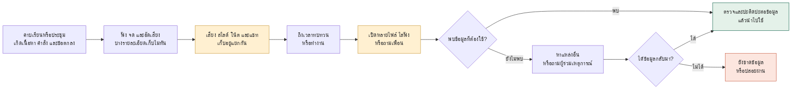
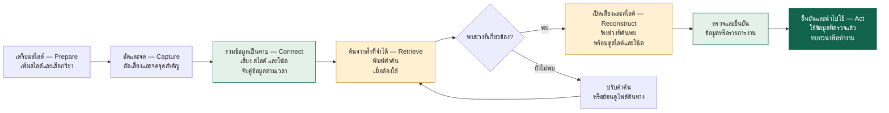

# Sherlock — Diagram ก่อนและหลังใช้

วันที่: 9 ตุลาคม 2569  
ประกอบชุดนำเสนอ 20 หน้า / 7 นาที

[เปิดคู่มือปรับสไลด์](SHERLOCK_20_SLIDE_REVISION_PLAN_TH.md)  
ต้นฉบับอ้างอิง: `AR - Week 2 แก้ตามอาจารย์ .pptx.pdf` หน้า 1–37 (ไฟล์ในเครื่อง ไม่ได้รวมใน repository นี้)

ทั้งสองภาพใช้สถานการณ์เดียวกัน: **นักศึกษาต้องย้อนหาข้อมูลจากคาบเรียนเมื่อต้องทบทวนหรือทำงาน** ก่อนใช้แสดงเส้นทางสังเคราะห์จาก Research; หลังใช้แสดงแนวคิดบริการที่เสนอ ผู้ใช้ยังเป็นคนตรวจและยืนยันข้อมูลก่อนนำไปใช้

## Diagram 1 — ก่อนใช้ Sherlock

**แกนเรื่อง:** เก็บข้อมูลไว้หลายที่ → ถึงเวลาต้องใช้ → ไล่หา → ปะติดปะต่อข้อมูล → นำไปใช้

**คำบรรยายใต้ภาพพร้อมใช้:**

> มีไฟล์แล้ว ยังต้องค้นและปะติดปะต่อข้อมูล ก่อนนำไปใช้

**ประโยคพูด:** “ก่อนมีบริการ ข้อมูลอยู่ในหลายไฟล์ พอต้องใช้จึงไล่หาและถามคนอื่น แล้วค่อยปะติดปะต่อข้อมูลก่อนทำงาน ถ้าหาไม่เจอก็ยังขาดรายละเอียดหรือปล่อยผ่านครับ”

**ที่มา:** หน้าเดิม 3, 6, 9–14 และ 23 เป็นเส้นทางสังเคราะห์ ไม่ได้หมายความว่าผู้ให้สัมภาษณ์ทุกคนผ่านทุกขั้น

**วางในชุดนำเสนอ:** ใช้อธิบายหน้า 7 หรือเป็นภาพอ้างอิงในบันทึกผู้พูด หากใช้ Journey 9 ช่วงบนสไลด์อยู่แล้ว ไม่วาง diagram เต็มซ้ำอีกภาพในหน้าเดียว

**ฉบับย่อสำหรับพื้นที่จำกัด**

> **ฟัง/จด/อัด → ไฟล์แยกกัน → ถึงเวลาต้องใช้ → ไล่หา/ถาม → ปะติดปะต่อข้อมูล → ทำงานหรือทบทวน**

กรณีหาไม่เจอวางเป็นลูกศรแยกจาก “ไล่หา/ถาม” ไปยัง “หาแหล่งอื่นหรือยังขาดข้อมูล”

## Diagram 2 — หลังใช้ Sherlock

**สถานะ:** แนวคิดบริการที่เสนอตาม Design Development และ Blueprint

**แกนเรื่อง:** เตรียมสไลด์ → อัดและจด → รวมข้อมูลเป็นคาบ → ค้นจากสิ่งที่จำได้ → เปิดเสียงและสไลด์ → ยืนยันและนำไปใช้

ใช้คำไทยเป็นชื่อช่วงหลัก และชื่ออังกฤษเป็นป้ายรองให้ตรงกับหน้า 13

**คำบรรยายใต้ภาพพร้อมใช้:**

> แนวคิดบริการ: ค้นจากสิ่งที่จำได้ เปิดเสียงและสไลด์ แล้วนำข้อมูลที่ตรวจแล้วไปใช้

**ตัวอย่างสำหรับบรรทัดใต้ diagram หน้า 13:**

> **ค้นว่า “ตอนที่อาจารย์ให้แก้บท 2” แล้วเปิดเสียงและสไลด์ช่วงนั้น ก่อนนำไปแก้งาน**

**ประโยคพูด:** “Sherlock รวมเสียง สไลด์ และโน้ตเป็นคาบเดียวกัน ให้ค้นจากสิ่งที่จำได้ แล้วเปิดเสียงกับสไลด์ช่วงนั้น ก่อนยืนยันข้อมูลและนำไปใช้ครับ”

**ที่มา:** หน้าเดิม 19, 25–27, 29 และ 31 การจับคู่ข้อมูลและขั้นตอนหลังใช้เป็นทิศทางบริการ; วิดีโอ MVP ใช้แสดงเฉพาะส่วนที่เดโมได้

**วางในชุดนำเสนอ:** ใช้เป็นแกนของหน้า 13: Design Development + Service Blueprint แล้วเพิ่มชั้น Frontstage/Backstage ใต้ขั้นตอนตาม diagram ในคู่มือหลัก ไม่เพิ่มหน้าสำหรับ diagram แยก

**ฉบับย่อสำหรับพื้นที่จำกัด**

> **เตรียมสไลด์ → อัดและจด → รวมข้อมูลเป็นคาบ → ค้นจากสิ่งที่จำได้ → เปิดเสียงและสไลด์ → ยืนยันและนำไปใช้**

## อ่านสองภาพคู่กันอย่างไร

| จุดในเส้นทาง | ก่อนใช้ | หลังใช้ตามแนวคิด |
|---|---|---|
| การเก็บ | ข้อมูลแยกอยู่ในหลายไฟล์/แอป | จัดเสียง สไลด์ และโน้ตเป็นคาบเดียวกัน |
| จุดเริ่มการค้น | จำได้ลาง ๆ แล้วไล่เปิดไฟล์ | ใช้สิ่งที่จำได้เป็นคำค้น |
| การตรวจความหมาย | ผู้ใช้ปะติดปะต่อข้อมูลเองจากหลายแหล่ง | เปิดเสียง สไลด์ และโน้ตของช่วงที่เกี่ยวข้อง |
| การนำไปใช้ | ทำงานหรือทบทวนจากข้อมูลที่หาได้ | ตรวจและยืนยันก่อนใช้ข้อมูลหรือรายการงาน |

สิ่งที่เปลี่ยนในภาพคือวิธีจัดและเรียกข้อมูลกลับมา ส่วนการตรวจความหมายและตัดสินใจใช้ข้อมูลยังมีผู้ใช้เป็นคนยืนยัน

## แนวทาง layout เมื่อย้ายไป Canva/PowerPoint

- ใช้ภาพแนวนอน ซ้ายไปขวา ให้ลำดับหลักเด่นกิ่งกรณีหาไม่เจอ
- ก่อนใช้: สีเทาหรือเขียวอ่อนกับแหล่งข้อมูล ใช้เหลืองเน้น “ไล่หา” และส้มเน้น “ยังขาดข้อมูล”
- หลังใช้: สีเขียวเป็นลำดับหลัก ใช้เหลืองเน้น Retrieve/Reconstruct ให้ตรงกับหน้า 13
- กิ่ง “ยังไม่พบ” อยู่ใต้ลำดับหลัก ไม่แทรกให้ขั้นตอนหลักสะดุด
- ใช้คำสั้นบนสไลด์ รายละเอียดเต็มอ่านจาก Mermaid ใน MD และรักษาจุด “ตรวจและยืนยัน” ก่อน Act
- ทั้งสอง diagram เป็นข้อความแก้ไขได้ ไม่ใช่ภาพ raster ที่ต้องพิมพ์ทับ
