# Sherlock — สคริปต์นำเสนอแยกสไลด์

อ้างอิงลำดับจาก **AR - FINALS.pdf จำนวน 20 หน้า** โดยไม่เปลี่ยนลำดับสไลด์ และใช้ภาพ Pre-service Journey เวอร์ชันใหม่ที่ผู้จัดทำเลือกแทนหน้า 7 บทพูดหน้า 11–20 ปรับตามไฟล์ “แก้.pdf” ที่ผู้จัดทำส่งเพิ่มเติม โดยคงบทหน้า 1–10 ไว้ตามฉบับที่ยอมรับแล้ว

**เป้าหมายรวม 6:30 นาที:** บทพูดและเปลี่ยนหน้า 5:45 นาที + วิดีโอหน้า 16 จำนวน 45 วินาที เหลือระยะเผื่อ 30 วินาทีจากเวลาที่อาจารย์กำหนด 7 นาที

เวลาที่ระบุเป็นกรอบสำหรับซ้อม ยังไม่ใช่ผลจับเวลาพูดจริง ใช้เฉพาะข้อความในกรอบคำพูดเป็นบทพูด ส่วน “มองแล้วนึก” เป็นคำช่วยจำ ไม่ต้องอ่านออกเสียง และ Red Team ท้ายไฟล์ใช้เตรียมตอบหลังนำเสนอ ไม่รวมใน 6:30 นาที

ผู้จัดทำยืนยันว่าเดโมยาว 45 วินาที และหน้า 17 เป็นการทดสอบกับผู้ใช้จริงพร้อมปรับต้นแบบแล้ว สคริปต์จึงเล่าตามสถานะนี้ โดยไม่เติมจำนวนผู้ทดสอบหรือผลเชิงปริมาณที่ยังไม่ได้ระบุ

**เรื่องที่เราจะเล่า:** จดและอัดไว้แต่หาไม่เจอ → ดูว่าคนติดตรงไหน → ช่วยให้ค้นเจอและกลับไปฟังได้ → ลองใช้แล้วปรับ → วางแผนขายและขยายต่อ

**จำหน้าที่ของสิบหน้าแรก:** 1 เปิดเรื่อง → 2 ช่วงที่ต้องใช้ → 3 สิ่งที่ติดในแต่ละสถานการณ์ → 4 ผลสำรวจและเครื่องมือที่ใช้ → 5 สี่วิธีรับมือ → 6 กลุ่มเป้าหมายหลักและเหตุผลที่เลือก → 7 เลือกแก้ขั้น 4–6 → 8 เทียบแอป → 9 ความเป็นไปได้ทางเทคนิค → 10 Value Proposition Canvas

**จุดเช็กเวลาตอนซ้อม:** จบหน้า 5 เวลา 1:14 · จบ Journey หน้า 7 เวลา 2:02 · จบหน้า 10 เวลา 3:08 · เริ่มวิดีโอ 4:36 · จบวิดีโอ 5:21 · จบทั้งหมด 6:30

---

## สไลด์ 1 — จดไว้ อัดไว้ พอจะใช้หาไม่เจอ

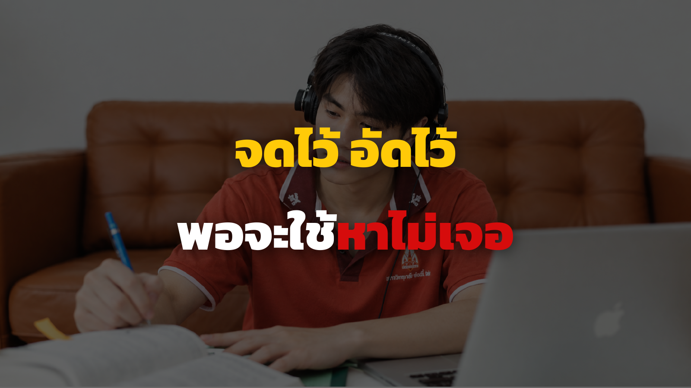

**เวลา 9 วินาที | 0:00–0:09** 
**มองแล้วนึก:** จดไว้ → อัดไว้ → หาไม่เจอ

> สวัสดีครับ เคยไหมครับ จดไว้แล้ว อัดเสียงไว้ด้วย แต่พอจะใช้กลับหาไม่เจอครับ

## สไลด์ 2 — ก่อนส่งงาน ก่อนสอบ

**เวลา 8 วินาที | 0:09–0:17** 
**มองแล้วนึก:** ก่อนส่งงาน → ก่อนสอบ → เสียเวลาค้นหา

> โดยเฉพาะก่อนส่งงานหรือก่อนสอบครับ เป็นช่วงที่ต้องใช้ข้อมูลแล้ว แต่กลับเสียเวลาไปกับการค้นหา

## สไลด์ 3 — สถานการณ์ที่เราเลือกศึกษา

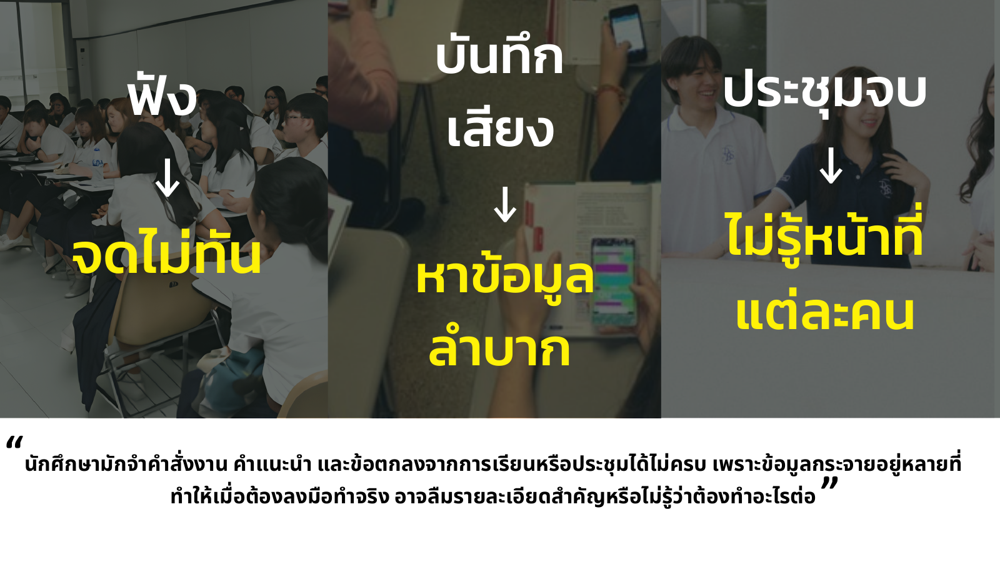

**เวลา 19 วินาที | 0:17–0:36** 
**มองแล้วนึก:** ฟัง: จดไม่ทัน → บันทึกเสียง: หาลำบาก → ประชุมจบ: ใครทำอะไร → ลงมือทำจริง

> ตอนฟัง เราจดไม่ทันครับ พออัดเสียงไว้ ก็หาข้อมูลลำบาก ส่วนประชุมจบ ก็ยังไม่ชัดว่าใครต้องทำอะไร พอถึงเวลาลงมือทำจริง เลยอาจลืมรายละเอียดสำคัญ หรือไม่รู้ว่าต้องทำอะไรต่อครับ

## สไลด์ 4 — ผลสำรวจบอกว่าปัญหากระทบอะไร

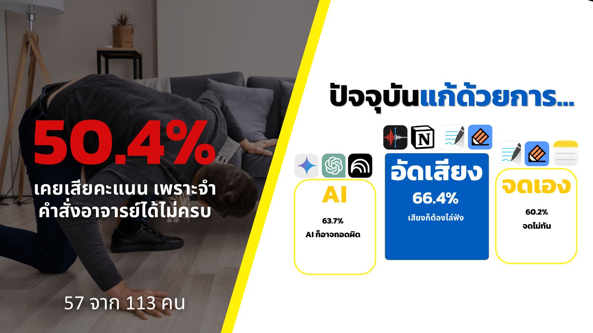

**เวลา 20 วินาที | 0:36–0:56** 
**มองแล้วนึก:** 50.4% เคยเสียคะแนน → AI: อาจถอดผิด → อัดเสียง: ต้องไล่ฟัง → จดเอง: ไม่ทัน

> จากที่เราสำรวจมา มี **50 กว่าเปอร์เซ็นต์ที่เคยเสียคะแนน** เพราะจำคำสั่งอาจารย์ได้ไม่ครบครับ ทุกวันนี้ก็มีทั้งใช้ AI อัดเสียง และจดเอง แต่ AI ก็อาจถอดผิด เสียงก็ต้องไล่ฟัง ส่วนจดเองก็อาจเก็บไม่ทันครับ

## สไลด์ 5 — สี่วิธีที่นักศึกษาใช้รับมือ

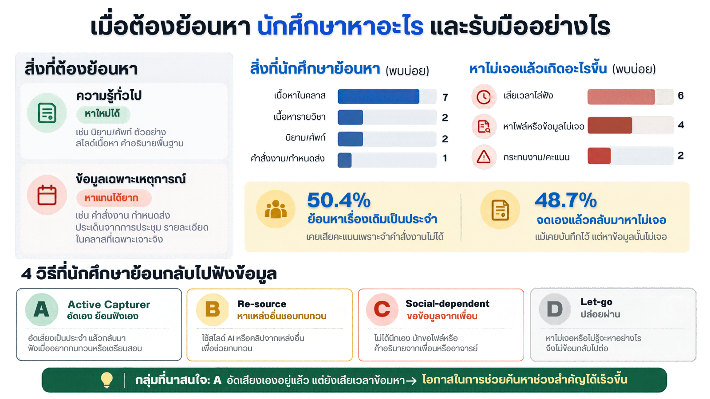

**เวลา 18 วินาที | 0:56–1:14** 
**มองแล้วนึก:** A Active Capturer: อัดเอง → B Re-source: หาแหล่งอื่น → C Social-dependent: ขอเพื่อน → D Let-go: ปล่อยผ่าน

> แล้วเวลาต้องย้อนหาข้อมูล นักศึกษารับมืออย่างไร เราเจอสี่วิธีครับ คือ **อัดเองแล้วกลับมาฟังเอง หาแหล่งอื่นทบทวน ขอข้อมูลจากเพื่อน และปล่อยผ่าน** จากสี่แบบนี้ เราเลือกมาดูต่อสองกลุ่มครับ

## สไลด์ 6 — คนที่จดและอัดเอง กับคนที่อาศัยโน้ตเพื่อน

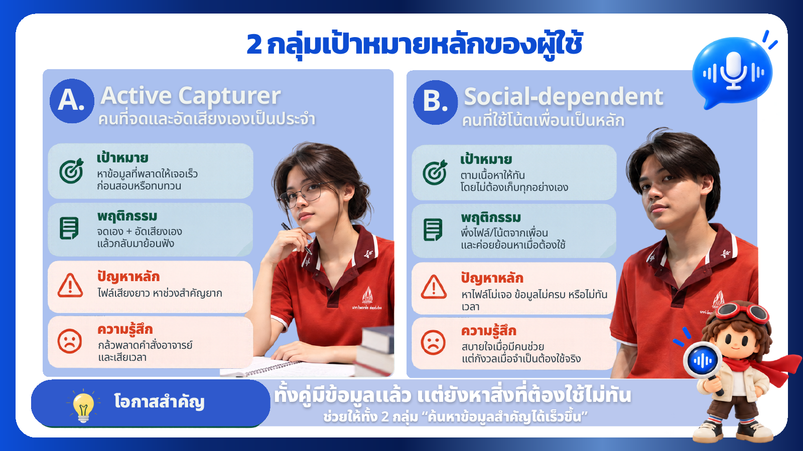

**เวลา 24 วินาที | 1:14–1:38** 
**มองแล้วนึก:** กลุ่มเป้าหมายหลัก → Active Capturer: จดและอัดเอง → Social-dependent: พึ่งข้อมูลเพื่อน → ตรงกับปัญหาที่จะแก้ → ค้นข้อมูลสำคัญเร็วขึ้น

> **กลุ่มเป้าหมายหลักของเรา** จึงเป็น **Active Capturer** ที่จดและอัดเอง กับ **Social-dependent** ที่พึ่งข้อมูลจากเพื่อนครับ เพราะทั้งคู่ติดปัญหาที่เราตั้งใจแก้ คือมีข้อมูลแล้ว แต่ยังหาสิ่งที่ต้องใช้ไม่ทัน เราจึงอยากช่วยให้ทั้งสองกลุ่มค้นหาข้อมูลสำคัญได้เร็วขึ้นครับ

## สไลด์ 7 — Journey: โฟกัสขั้น 4–6

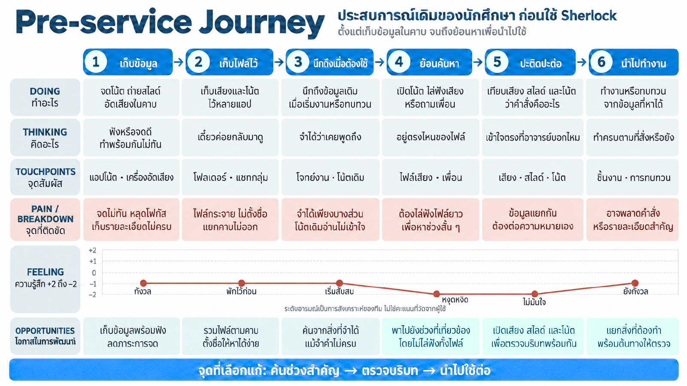

**เวลา 24 วินาที | 1:38–2:02** 
**มองแล้วนึก:** 4 ย้อนค้นหา: ไฟล์ยาว ช่วงสั้น → 5 ปะติดปะต่อ: ข้อมูลแยกกัน → 6 นำไปทำงาน: พลาดรายละเอียด

> ใน Journey นี้ เราโฟกัสที่ **ขั้น 4 5 และ 6** ครับ **ย้อนค้นหา** ต้องไล่ฟังไฟล์ยาวเพื่อหาช่วงสั้น ๆ **ปะติดปะต่อ** ข้อมูลแยกกัน ต้องเอามาต่อความหมายเอง และ **นำไปทำงาน** ก็อาจพลาดคำสั่งหรือรายละเอียดสำคัญ นี่คือสามจุดที่เราตั้งใจจะแก้ครับ

## สไลด์ 8 — เทียบแอปที่มีอยู่ แล้วเลือกสิ่งที่จะพัฒนาต่อ

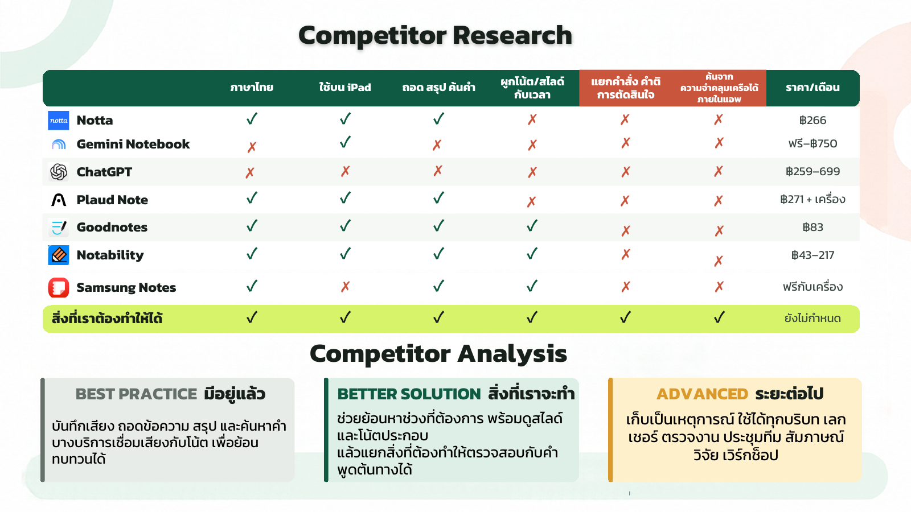

**เวลา 18 วินาที | 2:02–2:20** 
**มองแล้วนึก:** แอปที่มี: อัดและสรุป → สิ่งที่จะทำ: เสียงพร้อมสไลด์ → สิ่งที่ต้องทำ → ฟังคำพูดต้นทาง

> มาลองเทียบกับแอปที่มีอยู่แล้วครับ หลายแอปช่วยอัดและสรุปได้ สิ่งที่เราจะทำคือ **ค้นแล้วเปิดเสียงกับสไลด์ได้ด้วยกัน** แยกสิ่งที่ต้องทำ และกดกลับไปฟังได้ว่าอาจารย์พูดไว้อย่างไรครับ

## สไลด์ 9 — ความเป็นไปได้ทางเทคนิค

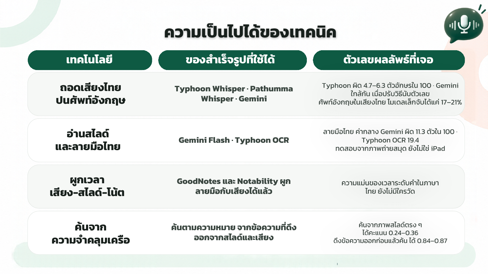

**เวลา 15 วินาที | 2:20–2:35** 
**มองแล้วนึก:** ถอดเสียง → อ่านสไลด์ → เชื่อมตามเวลา → ค้นจากคำที่จำได้ → fine-tune ให้เหมาะกับห้องเรียนจริง

> ด้าน **ความเป็นไปได้ทางเทคนิค** เราศึกษาทั้งการถอดเสียง อ่านสไลด์ เชื่อมตามเวลา และค้นจากคำที่จำได้ครับ มีเครื่องมือให้ต่อยอด และเราวางแผน **fine-tune เพิ่ม** ให้เหมาะกับเสียงและคำศัพท์ในห้องเรียนจริงครับ

## สไลด์ 10 — Value Proposition Canvas — จับคู่ความต้องการกับสิ่งที่แอปช่วยได้

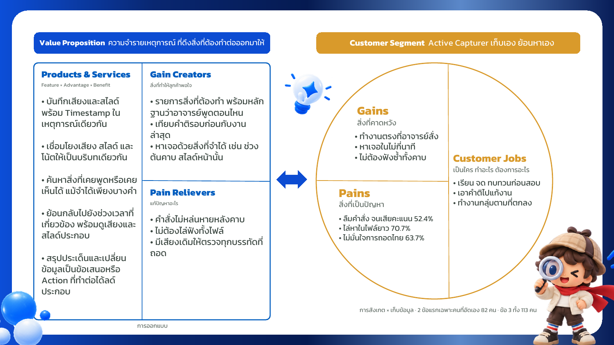

**เวลา 33 วินาที | 2:35–3:08** 
**มองแล้วนึก:** Customer Jobs: ทบทวนและแก้งาน → Pains: หายาก ลืมคำสั่ง → Gains: ทำงานตรงคำสั่ง → Products & Services: ค้นเสียงพร้อมสไลด์ → Pain Relievers: ฟังเฉพาะช่วง → Gain Creators: รายการงานพร้อมเสียงอ้างอิง

**ไล่ตามภาพ:** วงกลมด้านขวา: ช่องงาน → ปัญหา → สิ่งที่หวัง แล้วไปตารางด้านซ้าย: บริการ → ช่วยลดปัญหา → ช่วยให้ได้สิ่งที่หวัง

> หน้านี้คือ **Value Proposition Canvas** ครับ เริ่มจาก **Customer Jobs** คือทบทวนและแก้งาน แต่ติด **Pains** คือหาข้อมูลยากและลืมคำสั่ง ส่วน **Gains** ที่อยากได้คือทำงานตรงที่อาจารย์สั่ง
>
> เราเลยให้ค้นเสียงพร้อมสไลด์ เปิดฟังเฉพาะช่วงที่ต้องใช้ และมีรายการงานให้รู้ว่าต้องทำอะไรต่อครับ

## สไลด์ 11 — จำได้ว่าเคยพูด แต่หาไม่เจอ

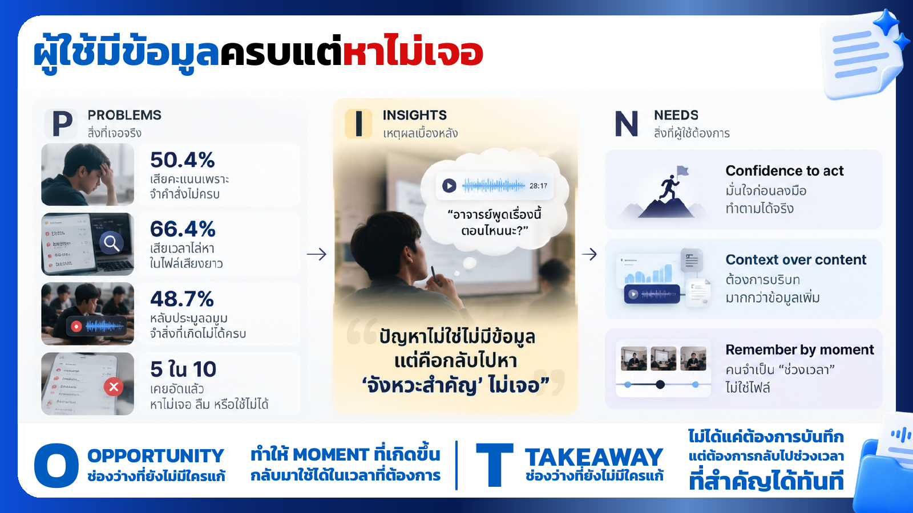

**เวลา 15 วินาที | 3:08–3:23** 
**มองแล้วนึก:** มีข้อมูลครบ → จำเรื่องได้ → จำไฟล์หรือนาทีไม่ได้ → ค้นจากคำที่จำได้

> ผู้ใช้มีข้อมูลครบแต่หาไม่เจอครับ เพราะเวลานึกย้อน เรามักจำได้แค่ว่า “อาจารย์เคยให้แก้เรื่องนี้” แต่จำไม่ได้ว่าอยู่ไฟล์ไหนหรือนาทีไหน เราจึงอยากให้เริ่มค้นจากคำที่ยังจำได้ครับ

## สไลด์ 12 — Final Problem Statement

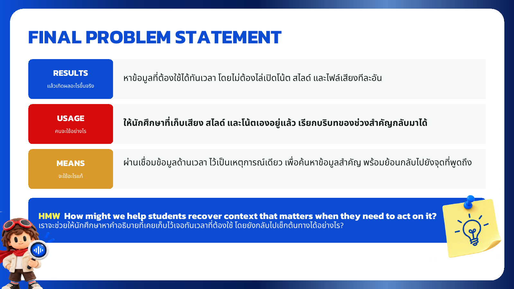

**เวลา 14 วินาที | 3:23–3:37** 
**มองแล้วนึก:** Final Problem Statement → นักศึกษาที่เก็บข้อมูลเอง → หาให้ทัน → เปิดฟังคำพูดอาจารย์

> นี่คือ **Final Problem Statement** ของเราครับ เราจะช่วยให้นักศึกษาที่เก็บเสียง สไลด์ หรือจดโน้ตเอง กลับมาหาข้อมูลที่ต้องใช้ได้ทัน และเปิดฟังได้ว่าอาจารย์พูดอะไรไว้

## สไลด์ 13 — ผู้ใช้ทำอะไร และระบบช่วยอย่างไร

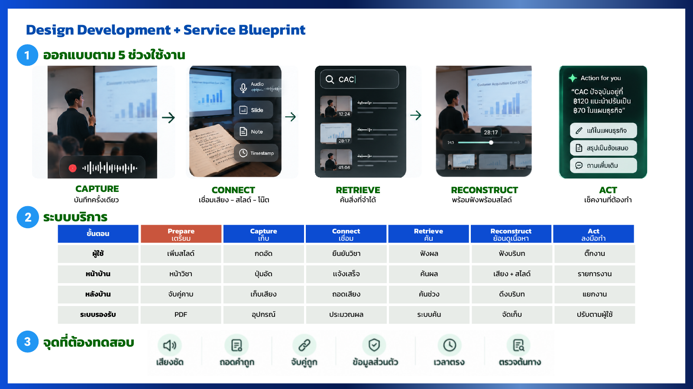

**เวลา 20 วินาที | 3:37–3:57** 
**มองแล้วนึก:** อัดเสียง → จับคู่สไลด์และโน้ต → เปิดย้อนดู → ทำงานต่อ → ตารางการทำงานของระบบ

> เราออกแบบการใช้งานไว้แบบนี้ครับ เริ่มจากอัดเสียง จับคู่สไลด์และโน้ต แล้วเปิดย้อนดู ก่อนนำข้อมูลไปทำงานต่อ ตารางด้านล่างบอกการทำงานของระบบในแต่ละขั้น เช่น ถอดเสียง หรือหาสไลด์ที่ตรงกับช่วงนั้นครับ

## สไลด์ 14 — เบลล์กำลังแก้งานบทสอง แต่จำคำแนะนำได้ลาง ๆ

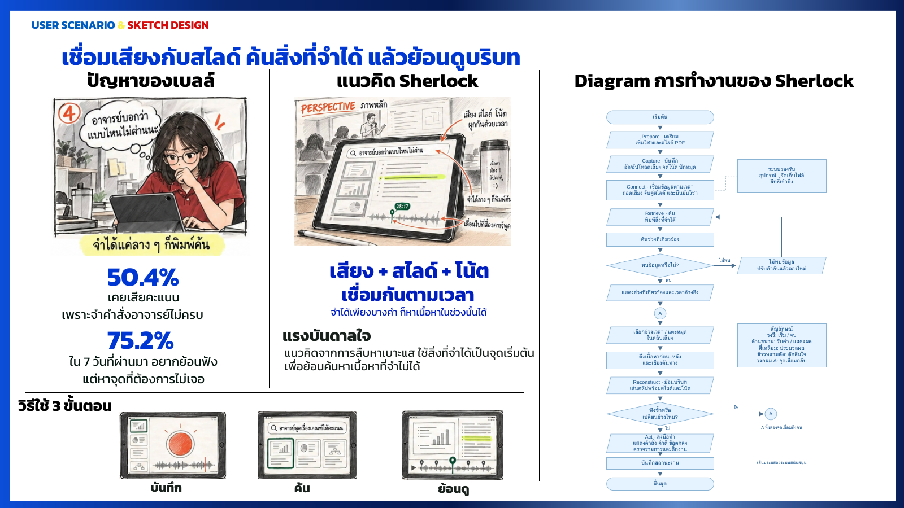

**เวลา 17 วินาที | 3:57–4:14** 
**มองแล้วนึก:** เบลล์แก้งานบทสอง → จำได้ลาง ๆ → ใช้คำที่จำได้ → ค้นเสียง สไลด์ และโน้ต

> สมมติว่าเบลล์กำลังแก้งานบทสอง แต่จำคำแนะนำได้แค่ลาง ๆ เลยนึกไม่ออกว่าต้องแก้จุดไหน เราเลยออกแบบ Sherlock ให้ใช้แค่คำที่จำได้ ค้นข้อมูลในเสียง สไลด์ และโน้ตที่เก็บไว้ครับ

## สไลด์ 15 — เบลล์ค้นแล้วเปิดฟัง ก่อนนำไปแก้งาน

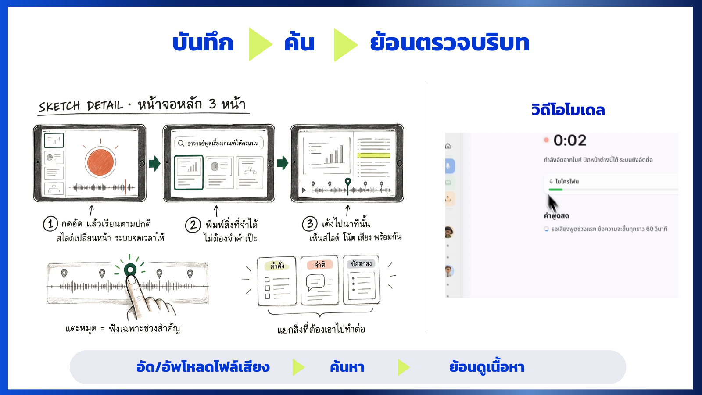

**เวลา 22 วินาที | 4:14–4:36** 
**มองแล้วนึก:** พิมพ์แก้งาน → เสียงพร้อมสไลด์ → ฟังเช็กคำแนะนำ → นำไปแก้งาน → ดูคลิปต้นแบบ

> พอพิมพ์ว่า “แก้งาน” ก็จะได้ช่วงเสียงกับสไลด์ที่เกี่ยวข้อง เบลล์กดฟังเพื่อเช็กว่าอาจารย์บอกอะไร แล้วค่อยเอาไปแก้งานได้ครับ นี่จึงเป็นที่มาของแอป Sherlock ที่เราทำเพื่อแก้ปัญหานี้ ต่อไปมาดูคลิปต้นแบบกันครับ

## สไลด์ 16 — วิดีโอเดโม Sherlock

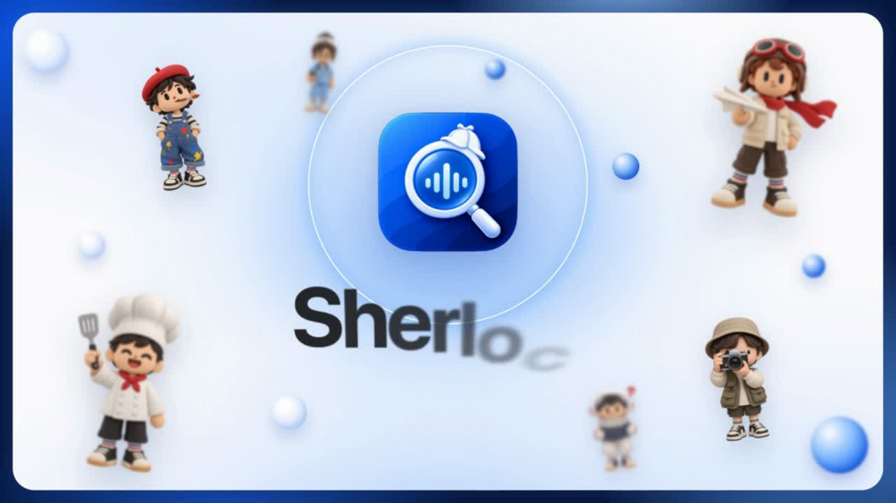

**เวลา 45 วินาที | 4:36–5:21** 
**มองแล้วนึก:** เปิดคลิป → หยุดพูด → รอจบ → เปลี่ยนหน้า

**การนำเสนอ:** เปิดวิดีโอเต็ม 45 วินาทีให้ทั้งห้องดู ไม่พูดทับคลิป เมื่อจบให้เปลี่ยนไปหน้า 17 แล้วเริ่มประโยคถัดไปทันที ภาพด้านบนเป็นภาพนิ่งจาก PDF ไม่ใช่ไฟล์วิดีโอ

## สไลด์ 17 — ลองใช้แล้ว เราปรับอะไรบ้าง

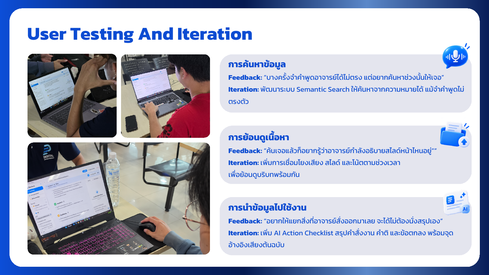

**เวลา 22 วินาที | 5:21–5:43** 
**มองแล้วนึก:** ทดลองใช้ → ค้นแม้จำคำไม่ตรง → เห็นสไลด์ → รู้ว่าต้องทำอะไร → ปรับตาม

> พอเอาต้นแบบไปทดลองใช้ เราได้คำแนะนำสามเรื่องครับ อยากค้นเจอแม้จำคำไม่ตรง อยากเห็นสไลด์ตอนที่อาจารย์พูด และอยากรู้ว่าต้องทำอะไรต่อ เราจึงปรับให้ค้นจากความหมาย เปิดเสียงพร้อมสไลด์และโน้ต และแยกรายการงานที่กดกลับไปฟังได้ครับ

## สไลด์ 18 — จะเริ่มขายให้ใคร และขายอย่างไร

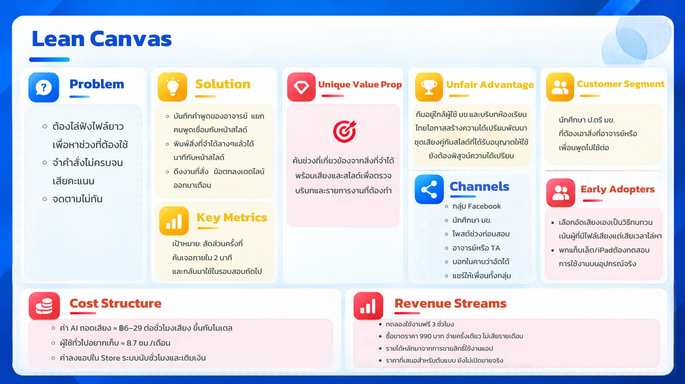

**เวลา 22 วินาที | 5:43–6:05** 
**มองแล้วนึก:** นักศึกษา มข. ที่อัดเอง → ฟรีสามชั่วโมง → 199 บาทต่อเดือน → หาเจอไหม → กลับมาใช้ไหม

> ส่วนแผนที่จะนำไปขาย เราจะเริ่มกับนักศึกษา มข. ที่อัดเสียงเอง ให้ลองฟรีสามชั่วโมง แล้วทดสอบราคา **199 บาทต่อเดือน** โดยชวนผ่านกลุ่มนักศึกษาและการบอกต่อ สิ่งที่จะดูคือเขาหาเรื่องที่ต้องการเจอไหม และกลับมาใช้อีกหรือเปล่าครับ

## สไลด์ 19 — ขนาดตลาด TAM SAM SOM

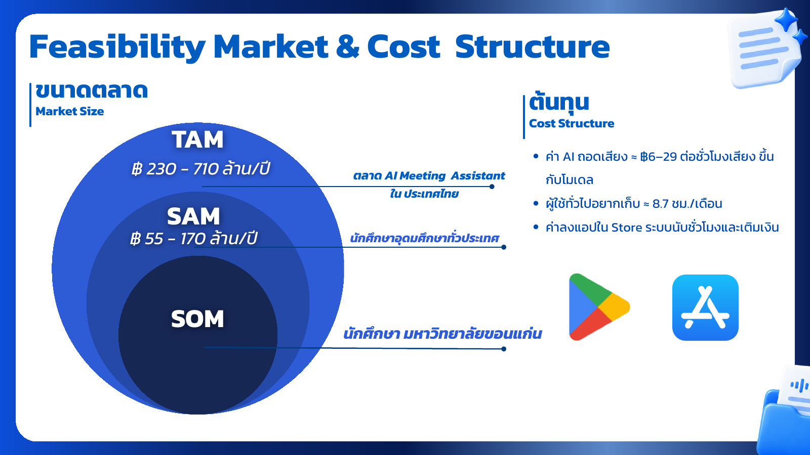

**เวลา 13 วินาที | 6:05–6:18** 
**มองแล้วนึก:** TAM / SAM / SOM → ตลาด AI ในไทย → เจาะนักศึกษา มข.

> หน้านี้เป็นขนาดตลาดที่เราประเมินไว้ ทั้ง **TAM SAM และ SOM** ครับ โดยมอง TAM จากตลาด AI ในประเทศไทย แล้วเจาะมาที่กลุ่มนักศึกษา มหาวิทยาลัยขอนแก่นครับ

## สไลด์ 20 — แผนสองเดือนและปิดการนำเสนอ

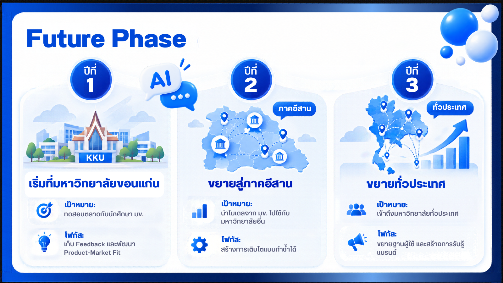

**เวลา 12 วินาที | 6:18–6:30** 
**มองแล้วนึก:** แผนสองเดือน → เริ่มที่ มข. → ขยายทั่วประเทศ → ขอบคุณ

> สุดท้ายคือ **แผนสองเดือนของเรา** ครับ โดยจะเริ่มที่มหาวิทยาลัยขอนแก่น แล้วขยายไปทั่วประเทศ ขอบคุณครับ

---

## วิธีซ้อมให้จบใน 6 นาทีครึ่ง

1. จำคำในบรรทัด **มองแล้วนึก** ก่อน แล้วพูดเชื่อมเป็นประโยค ไม่จำทุกคำและไม่อ่านข้อมูลทุกช่องในสไลด์
2. จับเวลาตั้งแต่คำว่า “สวัสดีครับ” จนถึง “ขอบคุณครับ” พร้อมเปิดเดโมจริงและเปลี่ยนหน้าจริง เวลาของแต่ละหน้ารวมจังหวะเปลี่ยนหน้าแล้ว
3. หน้า 7 เริ่มที่ขั้น **4–6** ในภาพได้เลย ไม่ย้อนเล่าตั้งแต่เก็บข้อมูล จบหน้า 7 ประมาณ **2:02** ส่วนหน้า 10 ให้ไล่ช่องในวงกลมด้านขวาแล้วไปตารางด้านซ้าย จบประมาณ **3:08** และเริ่มคลิปประมาณ **4:36**
4. ช่วงคลิปหยุดพูด เตรียมประโยคเปิดหน้า 17 ไว้ว่า **“พอเอาต้นแบบไปทดลองใช้…”** แล้วกลับเข้าสู่เรื่องทันทีเมื่อคลิปจบ
5. ซ้อมอย่างน้อยหนึ่งรอบโดยมองสไลด์เป็นหลัก ถ้าเกิน 6:30 ให้ลดคำขยายก่อน โดยคงปัญหา คุณค่า การทำงาน ผลปรับต้นแบบ และบทสรุปไว้

หน้า 14–15 ให้เล่าเป็นเรื่องของเบลล์ต่อกัน: หน้า 14 ตั้งปัญหาว่าจำคำแนะนำไม่ได้ พอเปลี่ยนหน้า 15 ให้พูดต่อทันทีว่า **“พอพิมพ์ว่า แก้งาน…”** แล้วพาเข้าคลิป ไม่ต้องเริ่มอธิบายสามหน้าจอใหม่

**ประโยคย่อสำรองเมื่อตามเวลาไม่ทัน** — ใช้แทนบทเดิม ไม่พูดเพิ่ม เวลาที่ลดได้ต้องเช็กจากการซ้อมจริง

| หน้า | บทพูดย่อ |
|---|---|
| 8 | “หลายแอปช่วยอัดและสรุปได้แล้วครับ เราจะให้ค้นเสียงพร้อมสไลด์ และแยกรายการงานที่กดกลับไปฟังคำสั่งได้ครับ” |
| 10 | “หน้านี้คือ Value Proposition Canvas ครับ ฝั่งลูกค้าบอกงานที่ต้องทำ ปัญหา และสิ่งที่หวัง ฝั่งบริการตอบด้วยการค้นเสียงพร้อมสไลด์ ช่วยลดเวลาหา และมีรายการงานที่กดกลับไปฟังได้ครับ” |
| 13 | “ผู้ใช้อัดเสียง ค้น แล้วเปิดย้อนดู ส่วนระบบช่วยถอดเสียงและหาสไลด์ที่ตรงกัน เพื่อให้ดูได้ว่าอาจารย์พูดอะไรไว้ครับ” |

### บันทึกสำหรับผู้พูด ไม่ต้องอ่านบนเวที

- ภาพหน้าอื่นเรนเดอร์จาก PDF ที่ส่งมาโดยตรง ส่วนหน้า 7 ใช้ภาพ Pre-service Journey เวอร์ชันใหม่ที่ผู้จัดทำเลือก ทุกภาพใช้ลิงก์ภาพที่อ้างจากโฟลเดอร์เดียวกัน ให้เก็บไฟล์ Markdown คู่กับโฟลเดอร์ `slides` เสมอ
- หน้า 4 คำว่า “50 กว่าเปอร์เซ็นต์” อ้างถึง 50.4% หรือ 57 จาก 113 คน ส่วนข้อจำกัดของเครื่องมือเป็นสิ่งที่ใช้ประกอบการออกแบบ ไม่ได้หมายความว่าผู้ตอบทุกคนพบข้อเสียครบทุกแบบ
- หน้า 5 เรียก Social-dependent ว่ากลุ่ม C แต่หน้า 6 ใช้ตัว B กำกับ Persona นี้ บทพูดจึงเรียกด้วยชื่อและพฤติกรรม เพื่อไม่ให้สับสนระหว่างสองหน้า
- หน้า 7 ใช้คำว่า Pre-service Journey ในความหมายว่า “ประสบการณ์เดิมก่อนใช้ Sherlock” ครอบคลุมตั้งแต่เก็บข้อมูลจนถึงนำไปใช้ เส้นอารมณ์เป็นภาพที่ทีมสรุปขึ้น ไม่ใช่คะแนนที่วัดจากผู้ใช้ และ แถวโอกาสในการพัฒนาเป็นแนวทางที่เสนอ ไม่ใช่ผลลัพธ์ที่พิสูจน์แล้ว ใช้เวลา 24 วินาทีเฉพาะขั้น 4–6: ย้อนค้นหา ปะติดปะต่อ และนำไปทำงาน ชี้ปัญหาแต่ละขั้น แล้วจบด้วย “นี่คือสามจุดที่เราตั้งใจจะแก้” ไม่ต้องเล่าขั้น 1–3 หรืออ่านคะแนนอารมณ์
- หน้า 8 มีรายละเอียดคู่แข่งและราคาที่เปลี่ยนได้ บทพูดจึงเน้นแนวคิดการออกแบบ ไม่อ่านเครื่องหมายกากบาทเป็นข้อสรุปว่าคู่แข่ง “ทำไม่ได้” ทั้งหมด
- หน้า 9 มีตัวเลขเทคนิคจากแหล่งอื่นอยู่ในภาพ สคริปต์ไม่เรียกตัวเลขเหล่านั้นว่าผลทดสอบ Sherlock และยังไม่ได้ตรวจสอบแหล่งต้นฉบับใหม่ในการทำสคริปต์นี้ คำว่า fine-tune ในบทพูดเป็นแผนพัฒนาเพิ่มเติม ไม่ใช่สิ่งที่ยืนยันว่าทำเสร็จแล้ว และยังต้องทดสอบการทำงานร่วมกันของระบบด้วย
- หน้า 12 ใช้หัวข้อ “RESULTS” ในสไลด์ แต่บทพูดกล่าวเป็นผลลัพธ์ที่ต้องการ ไม่อ้างว่าลดเวลาค้นหาได้แล้ว
- หน้า 17 ยืนยันการทดสอบและการปรับแล้วตามข้อมูลผู้จัดทำ แต่จำนวนผู้ทดสอบ วิธีวัด และผลก่อน–หลังยังไม่ปรากฏในข้อมูลที่ได้รับ
- บทพูดหน้า 18 ใช้ราคา 199 บาทต่อเดือน และหน้า 20 ใช้แผนสองเดือน ตามไฟล์ “แก้.pdf” ไม่อ้างว่าเปิดขายหรือขยายสำเร็จแล้ว ภาพประกอบยังเป็นสไลด์จาก “AR - FINALS.pdf” จึงมีราคา 990 บาทและแผนระยะเวลาเดิมที่ไม่ตรงกับบทใหม่ ต้องปรับสไลด์นำเสนอจริงให้ตรงก่อนใช้
- หน้า 19 ใช้กรอบตลาด AI ในประเทศไทยตามไฟล์แก้ไข แต่ยังไม่มีแหล่งข้อมูลหรือสูตรใหม่แนบมา จึงไม่ยกตัวเลขเดิมมาอ้างว่าเป็นตลาด AI ทั้งประเทศ และยังต้องทำขอบเขต TAM SAM SOM ให้สอดคล้องกัน
- คำว่า “16 ข้าม” ในไฟล์แก้ไขใช้กับบทพูด หน้า 16 ยังคงเปิดเดโม 45 วินาทีตามที่ตกลงไว้
- ตัวเลขต้นทุนและตลาดที่ใช้เตรียมคำตอบด้านล่างอ้างจากสไลด์ เป็นข้อมูลเพื่ออธิบายสมมติฐานของงานนี้ ไม่ใช่การตรวจสอบราคา API หรือตลาดล่าสุด

## Red Team — 10 คำถามที่อาจารย์อาจถาม พร้อมแนวตอบ

คำตอบชุดนี้ใช้หลังนำเสนอ ไม่รวมในเวลา 6:30 นาที หลักการคือ **ตอบตรงคำถาม → บอกสิ่งที่มีหลักฐาน → ระบุสิ่งที่จะพิสูจน์ต่อ** โดยไม่เติมผลทดสอบ ยอดขาย หรือข้อตกลงที่ยังไม่มี

### 1. ต่างจาก Goodnotes, NotebookLM หรือ ChatGPT อย่างไร ในเมื่อก็มี AI เหมือนกัน?

**แนวตอบ:**

> เราอยากให้คนพิมพ์สิ่งที่จำได้ แล้วกลับไปฟังคำพูดของอาจารย์พร้อมดูสไลด์ตอนนั้นได้ครับ แต่ถ้าจะบอกว่าดีกว่าแอปอื่นแค่ไหน ต้องลองให้คนหาเรื่องเดียวกันด้วยทั้งสองแอป แล้วดูว่าอันไหนหาได้ถูกและสะดวกกว่าครับ

**รับมือคำถามต่อ:** เสนอให้เปรียบเทียบกับเครื่องมือที่ผู้ใช้ใช้อยู่จริง โดยให้หาเรื่องเดียวกันจากไฟล์ชุดเดียวกัน วัดเวลาจนพบข้อมูลที่ถูกต้องและขั้นตอนที่ต้องใช้ ตารางคู่แข่งเพียงอย่างเดียวยังพิสูจน์ความเหนือกว่าไม่ได้

### 2. รู้ได้อย่างไรว่าคนต้องการ และทำไมเริ่มกับคนที่อัดเสียงเอง?

**แนวตอบ:**

> ข้อมูลจาก 113 คนช่วยให้เราเห็นปัญหาในกลุ่มที่ศึกษาครับ เราเลือกคนที่อัดเองก่อน เพราะเขามีไฟล์อยู่แล้ว แต่ยังติดตอนกลับไปหา ส่วนจะใช้ต่อหรือยอมจ่ายไหม เราต้องลองเพิ่ม ยังสรุปจากแบบสอบถามอย่างเดียวไม่ได้ครับ

**รับมือคำถามต่อ:** จากเอกสารแผนเดิม มีแบบสอบถาม 121 คำตอบ คัดเหลือ 113 คน และสัมภาษณ์ 10 คน รวม 29 เหตุการณ์ ตัวเลขส่วนนี้ไม่ได้แสดงครบใน PDF ล่าสุด จึงควรมีข้อมูลต้นทางและเกณฑ์คัดออกพร้อมอธิบาย หากใช้ตอบเรื่องวิธีวิจัย ไม่ควรตีความ 29 เหตุการณ์ว่าเป็นผู้ให้สัมภาษณ์ 29 คน

### 3. ทำไมตัวเลขปัญหาในแต่ละหน้าถึงไม่ตรงกัน เช่น 50.4% กับ 52.4%?

**แนวตอบ:**

> คำนวณจากคนละกลุ่มครับ 50.4% คือ 57 จากทั้งหมด 113 คน แต่ 52.4% กับ 70.7% คิดเฉพาะคนที่อัดเสียงเอง 82 คน ส่วน 63.7% คิดจากทั้งหมด 113 คน เวลาเทียบจึงต้องดูด้วยว่าคิดจากคนกลุ่มไหนครับ

**รับมือคำถามต่อ:** แยกปัญหาเรื่อง “คนละฐาน” ออกจาก “คำกำกับไม่สอดคล้อง” ในหน้า 5 ข้อความเด่นใกล้ 50.4% พูดถึงการย้อนหาเป็นประจำ ขณะที่หน้า 4 ใช้ตัวเลขนี้กับการเสียคะแนน และข้อความใกล้ 48.7% ก็ไม่ตรงกันระหว่างหน้า 5 กับ 11 หากถูกทัก ให้ยอมรับว่าคำกำกับต้องตรวจกลับกับคำถามต้นทาง อย่าใช้เหตุผลคนละฐานอธิบายทุกจุด บทพูดหน้าที่ 5 และ 11 จึงไม่อ่านตัวเลขเหล่านี้ซ้ำ

### 4. ทดสอบกับผู้ใช้จริงแล้วได้ผลอะไร มีหลักฐานว่าดีขึ้นหรือยัง?

**แนวตอบ:**

> ทดสอบและปรับแล้วครับ คนที่ลองอยากค้นได้แม้จำคำไม่ตรง อยากเห็นสไลด์ตอนนั้น และอยากให้แยกรายการงาน เราจึงปรับตามสามเรื่องนี้ ส่วนจะเร็วขึ้นเท่าไร ยังต้องจับเวลาเทียบก่อนและหลัง จึงจะตอบเป็นตัวเลขได้ครับ

**รับมือคำถามต่อ:** หากถามจำนวนคน ให้ตอบจำนวนจริงจากบันทึกทดสอบ ห้ามนำผู้ตอบแบบสอบถาม 113 คนหรือผู้ให้สัมภาษณ์เดิม 10 คนมาแทนจำนวนผู้ทดสอบต้นแบบโดยอัตโนมัติ หลักฐานที่ควรเตรียมคือโจทย์ทดสอบ บันทึกแต่ละคน และหน้าจอก่อน–หลังการปรับ

### 5. ถ้า AI ถอดผิดหรือแยกคำสั่งผิด จะยิ่งทำให้นักศึกษาทำงานผิดไหม?

**แนวตอบ:**

> มีโอกาสผิดครับ เราจึงให้กดกลับไปฟังเสียงจริงได้ โดยเฉพาะคำสั่งงานกับกำหนดส่ง ผู้ใช้ควรฟังให้แน่ใจก่อนทำตาม และเรายังต้องลองกับเสียงในห้องเรียนและคำศัพท์ของแต่ละวิชาเพิ่มครับ

**รับมือคำถามต่อ:** การมีต้นทางช่วยตรวจพบความผิดพลาด แต่ไม่ได้ทำให้ AI ถูกต้องโดยอัตโนมัติ ควรแยกการวัด “ถอดเสียงถูกไหม” “ค้นเจอช่วงที่ใช่ไหม” และ “รายการงานตรงคำสั่งไหม” ออกจากกัน ไม่รับประกันความถูกต้อง 100%

### 6. เชื่อมเสียงกับสไลด์ได้อย่างไร ถ้าอาจารย์ข้ามหน้า หรืออัปโหลดไฟล์ย้อนหลัง?

**แนวตอบ:**

> แนวทางคือบันทึกว่าเสียงช่วงไหนตรงกับสไลด์หน้าไหนครับ ถ้าเก็บเวลาตอนเปลี่ยนหน้าสไลด์ไว้ ก็ใช้จับคู่กันได้ แต่ถ้าเอาไฟล์เสียงกับ PDF เก่ามาใส่ทีหลังโดยไม่มีเวลาประกอบ การจับคู่จะยากขึ้น กรณีนี้เรายังต้องลองเพิ่มครับ

**รับมือคำถามต่อ:** ระบุให้ชัดว่าต้นแบบปัจจุบันทำส่วนไหนได้แล้วและส่วนไหนเป็นแบบออกแบบ หากการบันทึกเวลาตอนเปลี่ยนหน้าหรือการแก้คู่สไลด์ยังไม่ทำจริง ให้พูดว่าเป็นแนวทางพัฒนาต่อ ไม่เรียกเป็นฟีเจอร์ที่เสร็จแล้ว

### 7. อัดเสียงอาจารย์และเพื่อนแล้ว ข้อมูลส่วนตัวจะจัดการอย่างไร?

**แนวตอบ:**

> ก่อนใช้งานจริง ต้องขออนุญาตคนที่ถูกบันทึกเสียง และบอกให้ชัดว่าไฟล์จะเก็บที่ไหน ส่งให้บริการ AI ไหน และใครเปิดดูได้ครับ รวมถึงต้องมีวิธีลบไฟล์ด้วย ส่วนที่ยังทำไม่เสร็จต้องจัดการให้พร้อมก่อนเปิดใช้จริงครับ

**รับมือคำถามต่อ:** ตอบตามสถานะการจัดเก็บและบริการ AI ที่ใช้จริง อย่าอ้างว่าข้อมูลอยู่ในเครื่องทั้งหมด เข้ารหัสครบ หรือผ่านข้อกำหนดทุกด้านแล้ว หากยังไม่มีหลักฐาน และอย่าตอบว่าการขออนุญาตเพียงอย่างเดียวรับรองความพร้อมทั้งหมด

### 8. ราคา 199 บาทต่อเดือน จะพอจ่ายค่า AI หรือไม่?

**แนวตอบ:**

> 199 บาทเป็นราคาที่เราจะทดสอบครับ ยังต้องดูค่าใช้งานจริงและกำหนดว่ารวมกี่ชั่วโมง ถ้าคนใช้เยอะ ต้นทุนก็เพิ่มได้ เราจึงต้องดูทั้งความคุ้มค่าของผู้ใช้และค่าใช้จ่ายของระบบก่อนสรุปราคาครับ

**รับมือคำถามต่อ:** ตัวเลขต้นทุนในสไลด์เดิมเป็นสมมติฐาน ไม่ใช่ผลวัดจริงหรือราคาที่ตรวจสอบใหม่ หากใช้สมมติฐานเดิม 8.7 ชั่วโมงต่อเดือนและ 6–29 บาทต่อชั่วโมง ค่า AI จะอยู่ที่ 52.2–252.3 บาทต่อเดือน ซึ่งปลายช่วงสูงกว่าราคา 199 บาทแล้ว และยังไม่รวมค่าใช้จ่ายอื่น จึงยังสรุปว่ามีกำไรไม่ได้ โควตาหรือค่าเติมชั่วโมงยังเป็นทางเลือกที่ต้องตัดสินใจ

### 9. ทำไมใช้ตลาด AI ทั้งประเทศไทยเป็น TAM แล้ว SAM กับ SOM คิดอย่างไร?

**แนวตอบ:**

> ตลาด AI ในประเทศไทยเป็นภาพกว้างที่เราใช้เริ่มดูครับ แต่ยังนำทั้งตลาดมาเป็นตลาดที่ Sherlock ขายได้โดยตรงไม่ได้ ต้องเจาะว่ามีผู้ใช้ที่ตรงกับบริการเรากี่คน แล้วค่อยแยกกลุ่มที่เข้าถึงได้และกลุ่มที่คาดว่าจะเริ่มขายได้ โดยเราเริ่มที่นักศึกษา มข. ครับ

**รับมือคำถามต่อ:** ไฟล์แก้ไขยังไม่ให้แหล่งข้อมูลหรือสูตรใหม่ของแต่ละวง จึงไม่ควรอ้างว่าตัวเลขเดิมเป็นขนาดตลาด AI ทั้งประเทศหรือคำนวณใหม่จากราคา 199 บาทแล้ว ต้องกำหนดขอบเขตผู้ใช้และช่วงเวลาให้ตรงกัน รวมถึงตรวจจำนวนเดือนที่คาดว่าลูกค้าจะจ่ายจริงก่อนคำนวณรายได้ ห้ามเติมจำนวนผู้ซื้อหรืออัตราซื้อเพื่อให้ได้ตัวเลขเดิม

### 10. แผนสองเดือนจะขยายไปทั่วประเทศได้จริงหรือ และอะไรเป็นเกณฑ์ว่าควรไปต่อ?

**แนวตอบ:**

> สองเดือนเป็นกรอบแผนที่เราวางไว้ครับ โดยเริ่มที่ มข. ก่อน ส่วนการขยายทั่วประเทศยังเป็นเป้าหมาย ต้องดูว่าคนหาเรื่องที่ต้องการเจอจริงไหม กลับมาใช้ไหม และรายรับพอจ่ายค่าใช้งานหรือเปล่า ถ้ายังไม่ผ่านก็ต้องปรับก่อนครับ

**รับมือคำถามต่อ:** ยังไม่มีรายละเอียดกิจกรรมรายสัปดาห์ จำนวนผู้ใช้ หรือหลักฐานรองรับความเร็วในการขยายในไฟล์แก้ไข อย่าเสนอสิ่งเหล่านี้เป็นข้อเท็จจริงที่ทำแล้ว ควรวัดการค้นพบข้อมูลที่ถูกต้อง การกลับมาใช้ และต้นทุนจริงก่อนตัดสินใจขยาย หากต้องการตั้งเป้าเวลาค้นหา ต้องแยกเป้าหมายออกจากผลวัดที่เกิดขึ้นแล้ว
